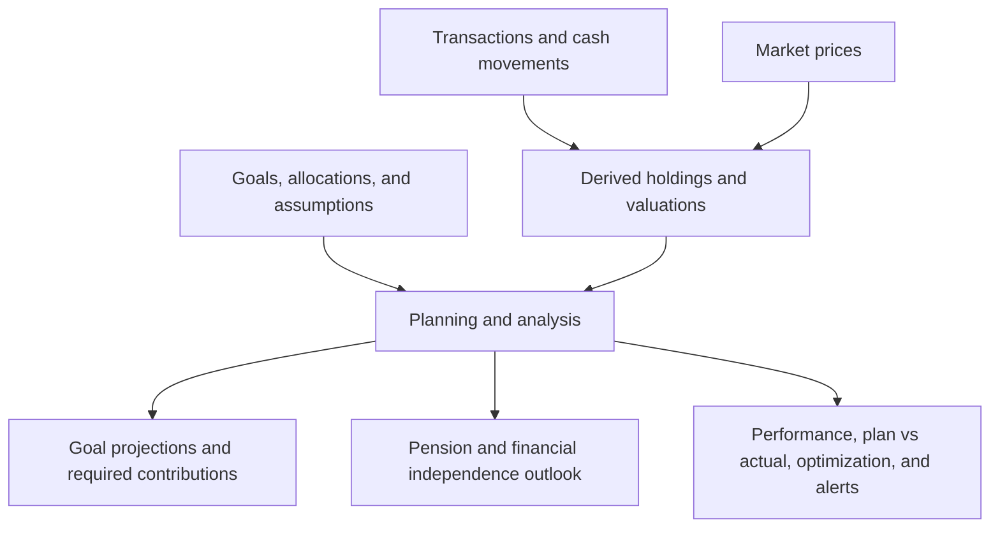
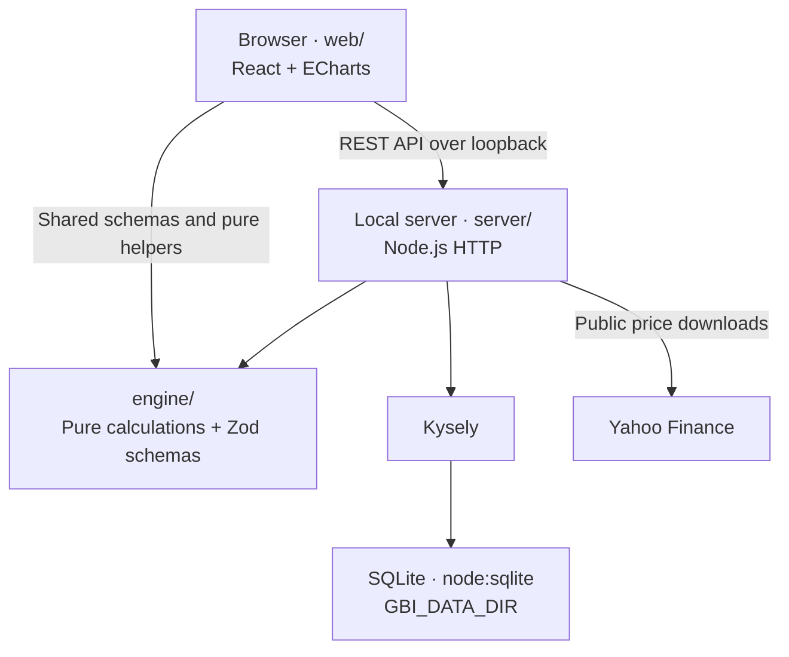

# GBI planner


[](LICENSE)

> **Newly public prototype.** Built for personal finance enthusiasts, with feedback and contributions welcome.
> Developed using an **Agent Development Life Cycle (ADLC)**, with coding agents working against a written spec and automated checks.

GBI planner is a goal-based investing app for connecting your investments to the things you want
to achieve: a future purchase, retirement, or financial independence. Define your goals, track your portfolio, and explore how
contributions, costs, taxes, and market assumptions affect your plan.

This project is a first experiment in building a product from idea to working application. Its
primary purpose is to learn by doing: exploring the different components of a product, from domain
modelling and financial calculations to the interface, API, storage, testing, and delivery, and
understanding how they fit together through agent-assisted development.

It is a local, single-user application: a browser interface backed by a server on your own computer.
Your financial records stay on your machine. The current planning model focuses on EUR investments
and the Italian context, including Fineco imports and pension funds. It helps you plan; it does not
execute trades.

[What you can do](#what-you-can-do) · [Install and run](#install-and-run) ·
[Architecture](#architecture) · [Tech stack](#tech-stack) · [Contributing](#contributing)

## What you can do

- Organize investments by goal, with target dates, allocations, and contribution plans.
- Track transactions, cash, holdings, and performance; import Fineco activity.
- Compare deterministic projections and Monte Carlo scenarios, and estimate required contributions.
- Explore pension planning, cash flow, and financial independence.
- Compare your plan with actual results, review alerts, and explore allocation optimization.

## Install and run

The app targets local use on macOS. You need **Node.js 24**, **pnpm 10.32.1**, and Git.
The pnpm version is pinned in `package.json`.

```sh
git clone https://github.com/radema/finance-os.git
cd finance-os
pnpm install
pnpm build
npm install -g .
gbi
```

`gbi` starts the server at **http://127.0.0.1:8716**, prints the URL and data directory, and opens
your default browser. Press **Ctrl+C** in the terminal to stop it. On an empty installation, use
**Load the sample data** to explore with synthetic records.

The global installation links to this repository. Keep the folder in place and run `pnpm build`
after updating the source.

### Data and configuration

The SQLite database lives outside the repository. All fonts and application libraries are bundled;
there is no CDN dependency. Public price downloads send ticker symbols and requested date ranges
to Yahoo Finance; your holdings and transaction records are not uploaded.

| Variable | Purpose | Default |
| --- | --- | --- |
| `GBI_DATA_DIR` | Folder for `gbi.sqlite`; created if missing | `~/Library/Application Support/gbi/` |
| `GBI_PORT` | Local server port | `8716` |

For example, to choose a separate data folder:

```sh
GBI_DATA_DIR="$HOME/gbi-data" gbi
```

## Architecture

### Logical flow

Goals and assumptions define the plan. Transactions, cash, and prices establish the current
position. The calculation engine brings them together to produce projections and analysis.



### Technical structure

The DAG below shows dependencies and calls, rather than request and response directions.



- **`engine/`** contains pure calculations, with no I/O or imports from the server or web layers.
- **`server/`** owns the REST API, price downloads, and database access. SQL goes through Kysely;
  migrations are forward-only, and money is stored as integer cents.
- **`web/`** renders the interface and accesses server data through the REST API.

Architecture boundaries are enforced by automated checks. The
[specification](.scratch/gbi-v1/spec.md) defines application behaviour; technical decisions live in
[ADRs](.scratch/gbi-v1/adr/).

## Tech stack

| Area | Technology |
| --- | --- |
| Language and runtime | TypeScript, Node.js 24 |
| Interface | React, Vite, Apache ECharts |
| API and validation | Node.js HTTP, shared Zod schemas |
| Storage | SQLite via `node:sqlite`, Kysely |
| Public prices | Yahoo Finance via `yahoo-finance2` |
| Quality checks | Biome, strict TypeScript, Vitest, fast-check |
| Package management | pnpm 10.32.1, exact dependency versions and committed lockfile |

## Contributing

Bug reports, documentation improvements, and focused fixes are welcome. Open an issue before
starting a larger feature or changing investing behaviour so we can agree on scope and any spec
updates first.

### Local development

After cloning and installing dependencies, start development with a separate data directory:

```sh
GBI_DATA_DIR="$HOME/gbi-dev-data" pnpm dev
```

This starts the API at `127.0.0.1:8716` and Vite at **http://127.0.0.1:8717**, with `/api` proxied to
the server. Stop any installed `gbi` instance first to free the API port. Without `GBI_DATA_DIR`,
development uses the same default database as the installed app.

### Submit a change

1. Read [AGENTS.md](AGENTS.md), the [specification](.scratch/gbi-v1/spec.md), and
   [DESIGN.md](DESIGN.md) for interface changes.
2. Create a `feat/...` branch from `main` and keep the change focused.
3. Run `pnpm test` while working and **`pnpm gate`** before submitting. The full gate runs lint and
   formatting checks, strict type checking, tests, a production build, and a dependency audit.
4. For UI changes, check the page with `agent-browser` and arrange a human visual review.
5. Use lowercase Conventional Commits referencing the relevant sub-issue or spec `AC-` identifier,
   then open a pull request to `main`. The maintainer handles merging.

Keep code, documentation, and UI text in English; the app includes an Italian glossary under
**Setup > Glossary**. Use synthetic fixtures in contributions and never
commit personal financial data. Agent-assisted contributions follow the same spec, review, and
verification requirements.

## License

[MIT](LICENSE). Bundled third-party assets retain their respective licenses.
