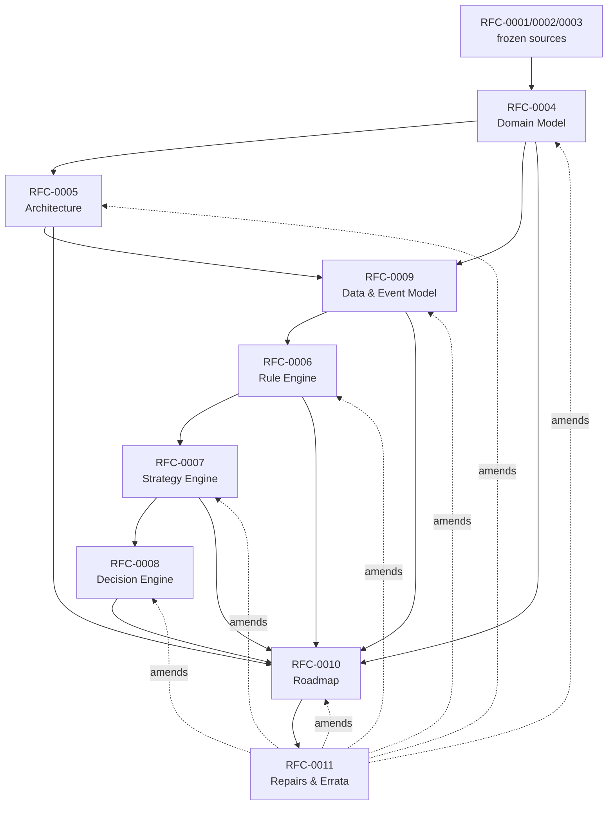

# RFC-0000 — Index

| | |
|---|---|
| **Status** | Living document — updated whenever any RFC changes status |
| **Role** | Navigational entry point for the Finance OS RFC corpus. Points, never restates. |
| **Last revised** | With RFC-0010 v0.3 |

---

## 1. Reading Order

**Newcomer path** (understand the product, then the system):

1. RFC-0001/0002/0003 (single source file) — vision, manifest, domain specification. *Italian, frozen, product-track owned.*
2. RFC-0004 — domain model. **Read with RFC-0011 open**: §2 (VirtualHolding), I-9, I-11, I-13, and the class diagram carry corrections.
3. RFC-0005 — architecture, stack, walking skeleton.
4. RFC-0009 — data & event model, trace schema. *Read before 0006–0008 despite the number: they build on its schemas.*
5. RFC-0006 → RFC-0007 → RFC-0008 — the three engines.
6. RFC-0010 — roadmap. §5 superseded by RFC-0011 §6.
7. RFC-0011 — consolidated repairs & errata. **Authoritative over all of the above where they conflict.**

**Builder path** (start the skeleton): RFC-0005 §8 → RFC-0009 §3–4 → RFC-0006 §12 → RFC-0011 ERR-1/ERR-2/ERR-7/ERR-8 and ADR-0027/0028 (they change migration `001_init.sql`).

---

## 2. Document Map

| Doc | Title | Track | Status | One-line scope |
|---|---|---|---|---|
| RFC-0001 | Product Vision | Product | Frozen v0.1 | Why Finance OS exists; pillars; original roadmap (amended by 0010 §4) |
| RFC-0002 | Manifest | Product | Frozen v0.1 | Eight principles; P3 (explainable) and P7 (reconstructable) are load-bearing everywhere |
| RFC-0003 | Domain Specification | Product | Frozen v0.1 | Entities, eight contexts, eight Domain Services, invariants, Ubiquitous Language |
| RFC-0004 | Domain Model | Technical | Proposed | Aggregates, VOs, derived models, contexts & contracts, invariants I-1…I-18 |
| RFC-0005 | Architecture & Walking Skeleton | Technical | Proposed | Hexagonal write / dataflow read, stack (Python, DuckDB, FastAPI+HTMX), CI contracts C1–C6, skeleton |
| RFC-0006 | Rule Engine | Technical | Proposed | Condition catalog, FactSet/Bound, TraceRecorder, four outcomes, step algebra |
| RFC-0007 | Strategy Engine | Technical | Proposed | Target tree, tolerance semantics, severity, drift, per-Bucket policy, freeze mechanics |
| RFC-0008 | Decision Engine | Technical | Proposed | Materialization, ordering, `mv_finding`, Decision lifecycle, explanation surface |
| RFC-0009 | Data & Event Model | Technical | Proposed | ADR-0004 resolution, physical schema, trace/provenance schemas, migration posture |
| RFC-0010 | Roadmap | Technical | Proposed | S → V1.0 → V1.1 → V1.2 → V2 → V3; amendments to RFC-0001; risk register |
| RFC-0011 | Consolidated Repairs & Errata | Technical | Proposed | ERR-1…ERR-10; ADR-0025…0031; E10/E11; wins conflicts against 0004–0010 |

---

## 3. Dependency Graph

Later documents correct earlier ones explicitly; RFC-0011 consolidates. Originals are never edited, so all `RFC-000X §Y` references remain stable.

---

## 4. Corrections Cross-Reference

Where to look before trusting a section of an original RFC.

| Original location | Corrected by |
|---|---|
| RFC-0004 §2.1 `TargetAllocation` VO; §6.2 I-13 | RFC-0007 ADR-0017; RFC-0011 ERR-5 |
| RFC-0004 §2.2 `VirtualHolding` as child entity; §6.2 I-9 | RFC-0011 ADR-0025 |
| RFC-0004 §5 class diagram (`Alert.strategyVersion`, `Strategy.goals`, `Bucket` fields) | RFC-0011 ERR-6, ADR-0030, ERR-9 |
| RFC-0004 §6.1 I-10 enforcement (DB grants) | RFC-0005 §5.2 |
| RFC-0004 §6.2 I-11 enforcement wording | RFC-0011 ERR-6 |
| RFC-0005 §5.2 STRUCT-for-traces claim | RFC-0009 ADR-0013 |
| RFC-0005 §6 recovery story (derivable only) | RFC-0009 §7.1 (authored-data export) |
| RFC-0005 §8 skeleton aggregate list / task 10 | RFC-0011 ERR-7 |
| RFC-0006 §3 Avail column (`indicator_threshold`, `concentration_above`) | RFC-0011 ERR-3 |
| RFC-0006 §3 `bucket_below_target_value` facts | RFC-0011 ERR-4 |
| RFC-0006 §3 catalog (missing kind) | RFC-0011 ADR-0025 adds `over_apportioned` (V1.0) |
| RFC-0006 §9 YAML defaults | RFC-0011 ERR-10 / R-3 |
| RFC-0007 §7 freeze trigger ("any change") | RFC-0011 ADR-0030 (Goal links excluded) |
| RFC-0008 §4 `mv_finding` reads `alert.severity` | RFC-0011 ERR-1 |
| RFC-0008 §12.4 `REJECTED` | RFC-0011 R-1 |
| RFC-0009 §3.1 `operation` DDL (types, checks, `TRANSFER`) | RFC-0011 ADR-0026 (`cash_leg_of`), ADR-0028 |
| RFC-0009 §3.2 `alert` / `evaluation_run` DDL | RFC-0011 ERR-1, ERR-2, ADR-0027 |
| RFC-0009 §3 missing DDL (`portfolio`, `portfolio_account`, `account`, `bucket`, `strategy`, `strategy_version`) | RFC-0011 ERR-8 |
| RFC-0009 ER `STRATEGY_VERSION ||--|{ RULE` | RFC-0011 ADR-0027 (document containment) |
| RFC-0010 §4.1 "V1.0 has no `Account`" | RFC-0011 ADR-0026 (reference entity) |
| RFC-0010 §5 ratification queue | RFC-0011 §6 (adds E10, E11) |
| RFC-0010 §3 V1.0 scope | RFC-0011 §5 (four additions); RFC-0010 v0.3 ADR-0037 (Import/Export UI added, entity CRUD UI moved to V1.1) |

---

## 5. ADR Registry

Full details in each owning RFC; RFC-0011 Appendix A is the cumulative table.

| Range | Owner | Subjects |
|---|---|---|
| ADR-0001…0003 | RFC-0004 | Apportionment model · `Decision` definition · `Holding` derived |
| ADR-0004 | RFC-0009 | Scope of reconstructability (value-pinned traces → targeted temporality) |
| ADR-0005…0010 | RFC-0005 | DuckDB · Pydantic · FastAPI+HTMX · single process · strategy files derived · defer commercialization |
| ADR-0011…0013 | RFC-0009 | Append-only supersession · reclassification as correction · trace as JSON |
| ADR-0014…0016 | RFC-0006 | Closed condition catalog · no forward chaining · `SKIPPED` distinct |
| ADR-0017…0020 | RFC-0007 | Target tree · tolerance semantics · dual bond valuation · Strategy as per-Bucket policy |
| ADR-0021…0023 | RFC-0008 | Findings derived · dismissal is a Decision · rationale from StrategyVersion |
| ADR-0024 | RFC-0010 | Cash Flow deferred to V1.1 (amended: ADR-0026) |
| ADR-0025…0031 | RFC-0011 | VirtualHolding derived · cash legs · rules embedded · OperationType widened · UNASSIGNED denominators · Goal links unfrozen · Market owns prices |
| ADR-0037 | RFC-0010 v0.3 | Entity management UI deferred to V1.1; Import/Export UI confirmed as V1.0's data-I/O UI scope |

Amended ADRs: **0001** (by 0025), **0013** (by ERR-1), **0024** (by 0026). None reversed.

Not yet indexed here: ADR-0032…0036 (RFC-0010 v0.2, RFC-0012) — pre-existing gap, flagged not fixed.

---

## 6. Invariant Registry

Current authoritative statement and enforcement owner per invariant. `WT` = write-time, `ET` = evaluation-time, `CI` = build contract, `TL` = type-level.

| ID | Invariant (current form) | Enforcement | Amended by |
|---|---|---|---|
| I-1 | `Holding` belongs to one `Asset` | TL — identity `(Portfolio, Asset)` | — |
| I-2 | `Asset` may belong to many `Bucket`s | Permission | — |
| I-3 | `Bucket` governed by one `Strategy` | WT — non-null FK | — |
| I-4 | `Strategy` has ≥1 `Rule` | WT — freeze-time constructor | — |
| I-5 | Every `Recommendation` derives from a `Rule` | TL — non-null provenance fields | — |
| I-6 | Every `Alert` explainable | TL + replay property test | — |
| I-7 | No engine writes to storage | CI — C2, no repo dependency | — |
| I-8 | All mutations pass through the domain | CI — C1/C4 | — |
| **I-9** | **Per Asset at any `as_of`, Σ apportioned ≤ Holding. Violation is reportable, not rejectable.** | **ET — `over_apportioned` kind; UI soft warning; DDL `quantity ≥ 0`** | **ADR-0025** |
| I-10 | `Operation`s append-only; corrections compensate | Repo port + CI C6 (no DB grants in DuckDB) | RFC-0005 §5.2; ADR-0028 (typed `CORRECTION`) |
| I-11 | Every `Alert` pins `(strategy, version, rule)` + inputs | TL via `run_id → evaluation_run` join | ERR-6 |
| I-12 | `Recommendation` never prescriptive | TL — no instrument/action/quantity fields; reflection test | — |
| **I-13** | **Children of every tree node sum to 1 (ε)** | WT — tree constructor | **ADR-0017 / ERR-5** |
| I-14 | Targets keyed by `AssetClass`, never `AssetId` | TL — map key type | — |
| I-15 | `Money` arithmetic requires same currency | TL — raises on mismatch | — |
| I-16 | `Snapshot`, `IndicatorReading` immutable | Frozen models, no update port | — |
| I-17 | `Recommendation` cannot reference `Decision` | TL — no field | — |
| I-18 | `Category` hierarchy acyclic | WT — cycle check on reparent | — |

Application-level integrity checks that compensate for dropped DB constraints (each guarded by a named test): `alert.rule_id` resolves within its run's version (ADR-0027); cash-leg pairing atomic (ADR-0026); transfer-pair atomicity and correction-of-pair rules (ADR-0028, open question RFC-0011 §8.3).

---

## 7. Extension & Ratification Queue

Authoritative version: RFC-0011 §6. Summary:

| Needs product ratification | Blocks | Technical / low-risk |
|---|---|---|
| **E1** ninth context `Decision` | **Skeleton** | E2 `StrategyVersion` · E3 `VirtualHolding` (derived per ADR-0025) · E4 `EvaluationRun` · E6 classification audit · E8 Strategy Engine siting · E11 Market owns prices |
| **E5** `Alert` = evaluation record | V1.0 | |
| **E7** `SuggestionClass` closed enum | V1.0 | |
| **E10** `OperationType` seven values | V1.0 | |
| **E9** `Goal`/`objective` split | V2 | |

Plus two roadmap amendments to RFC-0001 (Rule Engine → V1.0; Cash Flow → V1.1), pending the product track's RFC-0011+ *(product numbering — distinct from this technical RFC-0011)*.

---

## 8. Open Questions Registry

Live questions only — resolved ones are struck in their owning RFCs.

| Question | Owner | Target |
|---|---|---|
| E1/E5/E7/E9/E10 ratification; RFC-0001 amendments | Product track | E1 blocks skeleton |
| Multi-currency + FX bitemporal | RFC-0004 §10.5 / 0009 §10.7 | V2 |
| Tamper-evidence hash chain | RFC-0005 §10.3 / 0009 §10.4 | V1.2 |
| Migration testing posture confirmation | RFC-0005 §10.5 | Before migration 002 |
| Chart library | RFC-0005 §10.4 | V1.0, no dependency |
| Per-rule scope expansion ("every Bucket of this Strategy") | RFC-0006 §14.3 | Until it hurts |
| Rule backtest harness (and its epistemics) | RFC-0006 §14.6 | Unscheduled |
| `AssetClass` taxonomy ownership seam | RFC-0007 §12.2 | Second Strategy |
| Interior-node tolerances in UI | RFC-0007 §12.3 | V1.2 |
| Accrued interest: income or value | RFC-0007 §12.4 | Before V1.1 → V1.2 |
| Tolerance asymmetry | RFC-0007 §12.5 | If a rule wants it |
| Rebalancing calculator constraints | RFC-0007 §12.6 / 0008 §5.4 | V1.2, read-side only |
| Rationale localization | RFC-0008 §12.1 | When UI language fixed |
| Notification channel | RFC-0008 §12.2 | V2 |
| Finding severity history / sparkline indexing | RFC-0008 §12.3 | When it appears |
| Decision templates | RFC-0008 §12.5 | V2 |
| `NOT_FIRED` retention | RFC-0009 §10.3 | When it measurably hurts |
| Price licence recording | RFC-0009 §10.5 | With provider choice |
| E10/E11 ratification timing | RFC-0011 §8.1 | Now |
| Cash-leg display collapsing | RFC-0011 §8.2 | V1.0 templates |
| `CORRECTION` × `transfer_pair_id` × `cash_leg_of` truth table | RFC-0011 §8.3 | Skeleton task 3 |
| `over_apportioned` warning in CLI importer | RFC-0011 §8.4 | V1.0 |

---

## 9. Roadmap Snapshot

Authoritative version: RFC-0010 §3, as amended by RFC-0011 §5.

| Increment | Answers | Headline content |
|---|---|---|
| **S** | — | Spine + replay contract. One rule, one recommendation, inspectable trace. |
| **V1.0** | *Sto rispettando la mia strategia? Quanto è cambiato il mio patrimonio?* | Strategy compliance, Net Worth via cash-as-Asset, apportionment UI, five+1 rules (`over_apportioned` added), findings, run health, Reconcile, Market price half, Import/Export UI |
| **V1.1** | *Come sta andando il mese? Cosa dovrei fare oggi?* (loop closed) | Cash Flow context, `Transaction`↔cash-leg dedup, `Decision` capture, apportionment defaults, entity management UI |
| **V1.2** | *Quali rischi sto assumendo?* | Indicators, concentration, bonds/amortized cost, composite tolerances, hash chain, rebalancing calculator |
| **V2** | *Cosa succederà nei prossimi mesi?* | Forecast, Planning, `Goal`, scheduled ingestion, notification |
| **V3** | — | Knowledge context, AI assistant (read-only over traces/rationales/change notes) |

Kill criteria: RFC-0010 §6.2. The non-negotiable check: if the trace-replay property test cannot be maintained, stop — P3 is no longer true.

---

## 10. Maintenance Rules for This Index

1. Update on every RFC status change, every new ADR, every extension, and every resolved open question.
2. This document **points**; it never restates normative content. If a summary here conflicts with an owning RFC (as amended by RFC-0011), the owning RFC wins.
3. New corrections follow the corpus convention: a new amending document (RFC-0012+), never in-place edits — then a row in §4 here.
4. The product track's documents keep their own numbering; §7 tracks only what this track is waiting on.
