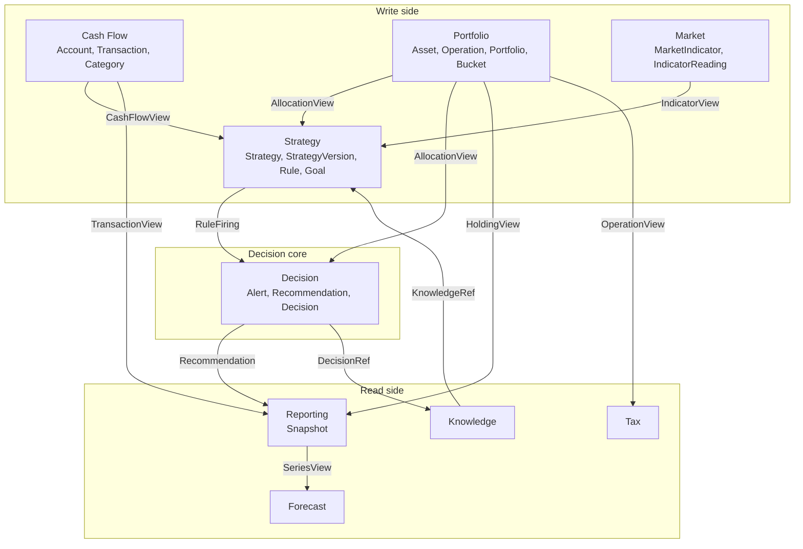
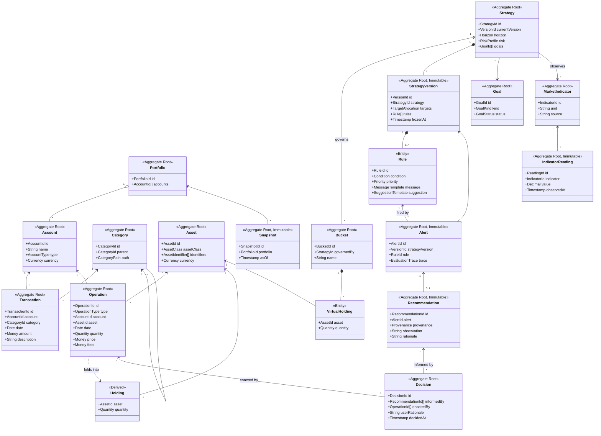

# RFC-0004 — Domain Model

| | |
|---|---|
| **Status** | Proposed |
| **Track** | Technical (0004–0010) |
| **Depends on** | RFC-0001/0002/0003 (authoritative, frozen) |
| **Consumed by** | RFC-0005 (Architecture), RFC-0006/0007/0008 (Engines), RFC-0009 (Data & Event Model) |
| **Language** | English. Ubiquitous Language terms used verbatim as declared in RFC-0003. |

---

## 1. Context

RFC-0003 declares entities, eight Domain Services, eight Bounded Contexts, an invariant list, and a twelve-term Ubiquitous Language. It does not declare aggregate boundaries, entity/value-object status, transactional consistency scopes, or context contracts. Without those, the "no engine writes to storage directly" invariant and Manifest Principles 3 and 7 are unimplementable — there is nothing to attach a provenance trace *to*.

This RFC closes that gap. It is **additive**: it does not restate the vision and does not alter the Ubiquitous Language. Where it must extend the source (three places, §8) it says so explicitly and marks the extension as requiring product-track ratification.

The load-bearing constraint from the brief governs every choice below:

- **P3** — every Recommendation traceable to the Rule and inputs that produced it.
- **P7** — every Decision fully reconstructable after the fact.

The single mechanism that satisfies both is **immutable definition versioning plus immutable facts**: rules are data, strategy definitions are versioned and frozen on write, Operations are append-only, and every generated artifact pins the exact version identifiers it consumed. This is developed below and is deliberately weaker than full event sourcing (see ADR-0003 and the deferred fork in RFC-0009).

---

## 2. Classification: Entity, Value Object, Derived

Three categories, not two. The third is the substantive modeling claim in this RFC.

### 2.1 Value Objects (immutable, no identity, compared by value)

| VO | Definition | Notes |
|---|---|---|
| `Money` | `(amount: Decimal, currency: ISO4217)` | Decimal only, never float. Arithmetic between differing currencies is a domain error (I-15). |
| `Quantity` | `(amount: Decimal, scale: int)` | Asset-scoped. Fractional units permitted. |
| `Weight` | `Decimal` in `[0,1]` | Used for target allocation. |
| `Tolerance` | `(kind: ABSOLUTE\|RELATIVE, band: Decimal)` | Attached per target allocation line. |
| `AssetClass` | Enumerated taxonomy node | The unit of target allocation. **Never an `Asset` id** — see I-14. |
| `AssetIdentifier` | `(scheme: ISIN\|TICKER\|INTERNAL, value: str)` | An `Asset` may carry several. |
| `CategoryPath` | Materialized ancestor path | Derived from the `Category` hierarchy for query ergonomics. |
| `Horizon` | `(years: int)` or `(target_date: Date)` | Strategy attribute. |
| `RiskProfile` | Ordinal enum + free-text principles | The `principi` attribute of `Strategy`. |
| `TargetAllocation` | `Map[AssetClass, (Weight, Tolerance)]` | Weights sum to 1 (I-13). |
| `Condition` | Declarative predicate AST | Rule input. Detailed in RFC-0006. |
| `Priority` | Ordinal enum | Rule attribute. |
| `MessageTemplate` | Parameterized string | Rule attribute; rendered with trace bindings. |
| `SuggestionTemplate` | Parameterized, non-prescriptive | Constrained by I-12. |
| `EvaluationTrace` | Ordered record of bound inputs, intermediate values, and outcome | The P3 carrier. Schema in RFC-0006. |
| `Provenance` | `(strategy_id, strategy_version, rule_id, input_refs[], evaluated_at)` | The P7 carrier. Schema in RFC-0008. |
| `AllocationBreakdown` | `Map[AssetClass, (Money, Weight)]` | Portfolio Engine output. |

### 2.2 Entities and Aggregates

An aggregate is a transactional consistency boundary. Cross-aggregate references are **by identity only**, never by object reference — this is what makes the domain core persistence-agnostic (RFC-0005) and what prevents the object graph from becoming the whole database.

| Aggregate Root | Child entities (inside boundary) | References (by id) | Rationale for the boundary |
|---|---|---|---|
| `Account` | — | — | Thin container. No invariant spans an Account and its Transactions; balance is derived, and a personal DSS enforces no overdraft rule. |
| `Transaction` | — | `Account`, `Category` | Own aggregate, **not** a child of `Account`. Volume is unbounded over time; making it a child would force loading the full history to append one row. |
| `Category` | — | parent `Category` | Self-referencing hierarchy. Cycle-freedom is I-18. |
| `Asset` | `AssetIdentifier`s (VO set) | — | Instrument definition only. Carries no quantity — quantity lives in `Operation`/`Holding`. |
| `Operation` | — | `Account`, `Asset` | **Immutable, append-only** (I-10). The atomic financial fact. Already an event in the source Ubiquitous Language, which is why event-shaped persistence costs almost nothing here. |
| `Portfolio` | — | `Account`s (set) | Deliberately thin: an identity plus the set of Accounts in scope. It does **not** contain `Holding`s (§2.3). |
| `Bucket` | `VirtualHolding` | `Strategy`, `Portfolio` | Apportionment must be transactionally consistent with the conservation invariant I-9, so `VirtualHolding` is a child, not a peer. |
| `Strategy` | `Rule`, `TargetAllocation` | `Goal`s, `MarketIndicator`s (observed) | I-4 ("at least one Rule") is a true invariant requiring atomic enforcement, so `Rule` must be inside. |
| `StrategyVersion` | frozen copy of `Strategy` + `Rule`s | `Strategy` | Immutable. Written on every mutation of `Strategy`. **This is the P7 anchor.** |
| `Goal` | — | — | Own aggregate: independent lifecycle (`ACTIVE`/`ACHIEVED`/`ABANDONED`) and referenceable by several Strategies. |
| `MarketIndicator` | — | — | Definition only (name, unit, source, cadence). |
| `IndicatorReading` | — | `MarketIndicator` | Append-only time series, separated from the definition for the same volume reason as `Transaction`. |
| `Snapshot` | — | `Portfolio` | Immutable checkpoint (I-16). Serves reporting, series, forecast. |
| `Alert` | — | `StrategyVersion`, `Rule`, input refs | Immutable. Carries `EvaluationTrace`. |
| `Recommendation` | — | `Alert`, `StrategyVersion`, `Rule` | Immutable. Carries `Provenance`. |
| `Decision` | — | `Recommendation`s, `Operation`s | The user's act. See ADR-0002. |

### 2.3 Derived Read Models (computed, never authored)

| Model | Identity | Computed from |
|---|---|---|
| `Holding` | `(Portfolio, Asset)` | Fold over `Operation`s |
| `AccountBalance` | `(Account, as_of)` | Fold over `Transaction`s + cash-affecting `Operation`s |
| `AllocationBreakdown` | `(Portfolio\|Bucket, as_of)` | `Holding` × `Asset.AssetClass` × valuation |
| `Drift` | `(Bucket, as_of)` | `AllocationBreakdown` vs `StrategyVersion.TargetAllocation` |

**`Holding` is derived, not stored** (ADR-0003). RFC-0003 defines `Operation` as "evento che modifica una Holding", which makes `Holding` the accumulator of an event stream rather than an independently authored fact. Treating it as a stored mutable aggregate would create two writable sources of truth for the same number and make P7 unenforceable — you could not tell whether a quantity changed because of an Operation or because something wrote to it. Materialization for performance is a persistence concern (RFC-0009), invisible to the domain.

---

## 3. Bucket ↔ Holding Apportionment (resolves source ambiguity #2)

The three source statements are jointly consistent only under a distinct entity:

- "Una Holding appartiene ad un solo Asset"
- "Un Asset può appartenere a più Bucket"
- "Un Bucket contiene Holdings virtuali"

**Decision (ADR-0001): quantity-based `VirtualHolding`.**

```
Holding        = (Portfolio, Asset) -> Quantity     [derived, real]
VirtualHolding = (Bucket, Asset)    -> Quantity     [stored, authored]
```

Conservation (I-9): for each `Asset`, the sum of `VirtualHolding.quantity` across all `Bucket`s of a `Portfolio` must be **≤** the real `Holding.quantity`. The residual is exposed as a computed `UNASSIGNED` pseudo-bucket rather than silently absorbed — unapportioned capital is itself a finding the Decision context should be able to surface.

Quantity-based is chosen over weight-based because weights must be renormalized on every Operation, which mutates every Bucket's effective position as a side effect of an unrelated purchase. That is implicit state change with no auditable cause, and it breaks P7 directly.

---

## 4. Bounded Contexts and Contracts

Eight contexts are declared in RFC-0003. `Alert`, `Recommendation`, and `Decision` belong to none of them, while `Decision Engine` is a Vision pillar with no context and no Domain Service. A **ninth context, `Decision`**, is introduced to hold them (§8, extension E1).



### 4.1 Contracts

Each arrow is a **port** owned by the *consuming* context and implemented by an adapter over the producing context. Payloads are flat DTOs of primitives and shared VOs — no aggregate crosses a boundary.

| Contract | Producer → Consumer | Payload | Direction guarantee |
|---|---|---|---|
| `AllocationView` | Portfolio → Strategy, Decision | `(scope, as_of, AllocationBreakdown, holding_refs[])` | Read-only. Portfolio has no knowledge of Strategy. |
| `CashFlowView` | Cash Flow → Strategy | `(period, run_rate: Money, by_category)` | Read-only. |
| `IndicatorView` | Market → Strategy | `(indicator_id, reading_id, value, observed_at)` | Pins `reading_id` so evaluation is replayable. |
| `RuleFiring` | Strategy → Decision | `(strategy_id, strategy_version, rule_id, outcome, EvaluationTrace)` | Strategy does not construct Recommendations. |
| `Recommendation` | Decision → Reporting | `(recommendation_id, Provenance, observation, rationale)` | Reporting is read-only everywhere. |
| `SeriesView` | Reporting → Forecast | `(metric, Snapshot[])` | Forecast never reads write-side aggregates. |
| `OperationView` | Portfolio → Tax | `(Operation[], cost basis inputs)` | Tax estimates only; no write path. |

**Shared kernel** — deliberately minimal: `Money`, `Quantity`, `Weight`, `Percentage`, and the identity types. `AssetClass` is owned by Portfolio and consumed as an opaque taxonomy key by Strategy, which is what keeps I-14 enforceable.

**No context depends on `Decision`.** Dependency edges into the Decision context are inbound only (except the Knowledge back-reference, which is by id). This is what makes the Decision context replaceable and the Recommendation pipeline testable in isolation.

---

## 5. Class / Relationship Diagram



---

## 6. Invariants as Enforceable Rules

Each invariant is restated with a **mechanical enforcement point**. "Enforced by review" is not an enforcement point.

### 6.1 From RFC-0003

| ID | Invariant | Enforcement |
|---|---|---|
| **I-1** | A `Holding` belongs to exactly one `Asset`. | Structural: `Holding` identity is `(Portfolio, Asset)`. Unrepresentable otherwise. |
| **I-2** | An `Asset` may belong to many `Bucket`s. | Permission, not constraint. No uniqueness on `VirtualHolding.asset`. |
| **I-3** | A `Bucket` is governed by one `Strategy`. | Non-nullable `Bucket.governedBy`; FK + constructor precondition. |
| **I-4** | A `Strategy` contains at least one `Rule`. | `StrategyVersion` constructor rejects an empty rule set. Enforced at freeze time, so it cannot be transiently violated. |
| **I-5** | Every `Recommendation` derives from a `Rule`. | Non-nullable `Provenance.rule_id` + non-nullable `alert_id`. No constructor path without them. |
| **I-6** | Every `Alert` is explainable. | Non-nullable `EvaluationTrace`; constructor rejects an empty or unbound trace. Property test: trace replay reproduces the outcome. |
| **I-7** | No engine writes to storage directly. | Architectural: engines are pure functions `(inputs) -> outputs` with **no repository dependency injected**. Only application services hold repository ports (RFC-0005). Enforced by import-linter contract in CI. |
| **I-8** | All mutations pass through the domain. | Repository ports accept aggregate roots only, never DTOs or raw rows. No SQL outside adapters; enforced by the same CI contract. |

### 6.2 Added by this RFC

| ID | Invariant | Enforcement |
|---|---|---|
| **I-9** | Per `Asset`, `Σ VirtualHolding.quantity ≤ Holding.quantity`. | Checked in the `Bucket` aggregate on apportionment, against an injected `HoldingView` value (not a repository). Residual surfaced as `UNASSIGNED`. |
| **I-10** | `Operation`s are immutable and append-only. | No setters; corrections are compensating `Operation`s. DB: no `UPDATE`/`DELETE` grant on the table. |
| **I-11** | Every `Alert` pins `(strategy_id, strategy_version, rule_id)` and every input reference used. | Non-nullable fields; `StrategyVersion` rows are immutable, so the pin can never dangle or drift. |
| **I-12** | A `Recommendation` is never prescriptive. | **Structural, not stylistic**: the schema has `observation` + `rationale` + optional `suggestion_class`. There is no `(instrument, action, quantity)` triple to populate. A prescriptive recommendation is unrepresentable. |
| **I-13** | `TargetAllocation` weights sum to 1. | `TargetAllocation` VO constructor, with an explicit Decimal epsilon. |
| **I-14** | `TargetAllocation` keys are `AssetClass`, never `AssetId`. | Type-level: the map key type is `AssetClass`. This is Manifest P4 made unrepresentable-if-violated. |
| **I-15** | `Money` arithmetic requires identical currency. | `Money.__add__` raises on mismatch. No implicit conversion anywhere in the core. |
| **I-16** | `Snapshot` and `IndicatorReading` are immutable. | Frozen dataclasses; no update path in the repository port. |
| **I-17** | `Recommendation` cannot reference `Decision`. | Type-level: no such field. Preserves the acyclic dependency in §4. |
| **I-18** | The `Category` hierarchy is acyclic. | Cycle check on reparent; `CategoryPath` recomputed. |

---

## 7. Definition of `Decision` (resolves source ambiguity #3)

`Decision` is in the Ubiquitous Language, is the subject of Manifest P7, and has no entity definition in RFC-0003. It is also the only term for which the source gives no attributes — the thing the entire architecture is required to make reconstructable.

**Decision (ADR-0002): a `Decision` is the *user's* act, not the system's.**

```
Decision = (id, informedBy: Recommendation[], enactedBy: Operation[],
            userRationale, decidedAt, status)
```

This is the only reading that makes P6 and P7 mutually coherent. P6 states the application does not replace human judgement; therefore the system never makes decisions, only Recommendations. If `Decision` meant "system output" it would be a synonym for `Recommendation` and P7 would collapse into P3, leaving the Ubiquitous Language with a redundant term. Under the reading above, P7 becomes a distinct and much stronger requirement: reconstruct **why the human chose what they chose** — which Recommendations were visible, from which StrategyVersion, against which portfolio state, and which Operations followed.

`informedBy` may legitimately be empty: decisions taken against the system's findings, or with no finding at all, are exactly the ones worth auditing later.

---

## 8. Extensions to the Source (require product-track ratification)

Marked explicitly because RFC-0001/0003 are frozen and owned by the other track.

| ID | Extension | Why unavoidable |
|---|---|---|
| **E1** | Ninth bounded context `Decision`, owning `Alert`, `Recommendation`, `Decision`. | The three entities exist in RFC-0003 but belong to none of the eight contexts, and `Decision Engine` is a Vision pillar with no context. Placing them in `Strategy` would make Strategy depend on its own consumers. |
| **E2** | `StrategyVersion` as a first-class immutable aggregate. | P7 is unimplementable if a `Strategy` can be edited in place: a past Alert's rule reference would silently change meaning. Not in the source Ubiquitous Language, so it is a *technical* term, not a domain term. |
| **E3** | `VirtualHolding` as a named entity. | RFC-0003 says "Holdings virtuali" in prose; this only promotes that phrase to an entity. Lowest-risk of the three. |

**`Decision Engine`** is *not* introduced as a ninth Domain Service. It is a composition over the Rule Engine plus prioritization and deduplication, living in the `Decision` context. Resolved definitively in RFC-0008; recorded here because it constrains §4.

---

## 9. Consequences

**Positive**

- P3 and P7 hold structurally rather than by convention: I-6, I-11, I-12 and I-14 make the violating states unrepresentable in the type system.
- `Holding` as derived removes the classic dual-source-of-truth bug for the number the user cares about most.
- Engines being repository-free (I-7) makes them pure and testable, and is checkable in CI rather than in review.
- The domain core stays free of framework and DB types, satisfying Manifest P8.

**Negative / accepted costs**

- Every `Strategy` edit writes a new `StrategyVersion`. For a single user this is negligible in volume but adds a write path and a "which version am I looking at" concern in the UI.
- Deriving `Holding` from `Operation`s means a fold on every read until materialization exists. Acceptable at personal scale; RFC-0009 specifies the materialization.
- Nine aggregates on the write side is more ceremony than a prototype strictly needs. The walking skeleton in RFC-0005 exercises only `Asset`, `Operation`, `Bucket`, `Strategy`/`StrategyVersion`, `Rule`, `Alert`, `Recommendation` — the rest are defined but not built first.
- E1–E3 create a real divergence between the technical model and the frozen product documents until ratified.

---

## 10. Open Questions

1. **E1–E3 ratification.** Does the product track accept the ninth context and the two new technical terms, or should the source documents absorb them?
2. **Reconstructability scope** — the deferred fork. Decision-level (this RFC's assumption) vs full event sourcing. RFC-0009, ADR-0004. Nothing here forecloses either, since `Operation` is append-only in both.
3. **`Goal` ↔ `Strategy` cardinality.** Modeled many-to-many. RFC-0003 also gives `Strategy` an `obiettivo` attribute, which may be the same concept expressed twice. Needs a product answer.
4. **Valuation source for `AllocationBreakdown`.** Requires an asset price series. Not in RFC-0003's Market context, which lists only macro indicators. RFC-0005/0009 must site it.
5. **Multi-currency.** I-15 forbids implicit conversion, but no context currently owns FX rates. Deferred; V1 assumes a single reporting currency.
6. **`Transaction` ↔ `Operation` overlap.** A `Buy` reduces cash in an `Account` and is also an `Operation`. Whether cash legs are auto-derived or dual-entered is a Cash Flow/Portfolio contract question for RFC-0009.

---

## Appendix A — ADR Index

To be extracted to `docs/decisions/`. MADR 4.0.

| ADR | Title | Status | Owner RFC |
|---|---|---|---|
| ADR-0001 | Bucket apportionment model | Accepted | RFC-0004 |
| ADR-0002 | Definition of `Decision` | Accepted | RFC-0004 |
| ADR-0003 | `Holding` as derived read model | Accepted | RFC-0004 |
| ADR-0004 | Scope of reconstructability | **Open** | RFC-0009 |

---

### ADR-0001 — Bucket apportionment model

**Context.** RFC-0003 states a `Holding` belongs to one `Asset`, an `Asset` may belong to several `Bucket`s, and a `Bucket` contains virtual Holdings. The split model is unspecified. Drift computation, and therefore the entire V1 slice, depends on it.

**Decision Drivers.** P7 reconstructability; no implicit state change; exactness under repeated Operations; simplicity for a solo build.

**Considered Options.**
1. *Quantity-based `VirtualHolding`* — Bucket stores an explicit quantity per Asset.
2. *Weight-based* — Bucket stores a percentage claim per Asset.
3. *Bucket-scoped Operations* — every Operation is tagged with a Bucket at entry.

**Decision Outcome.** Option 1. Option 2 renormalizes silently on every unrelated purchase, changing every Bucket's effective position with no auditable cause — a direct P7 violation. Option 3 is exact and audit-friendly but forces a Bucket decision at import time, before the user knows their allocation, and cannot express an Asset spanning Buckets without splitting the Operation.

**Consequences.** Apportionment becomes an explicit user act (good: auditable; cost: manual). Requires conservation invariant I-9 and an `UNASSIGNED` residual. New Operations land unassigned by default, which is honest but adds a routine chore — mitigable later with apportionment rules, deferred past V1.

---

### ADR-0002 — Definition of `Decision`

**Context.** `Decision` is in the Ubiquitous Language, is what Manifest P7 quantifies over, and has no definition or attributes in RFC-0003.

**Decision Drivers.** P6 (system does not replace human judgement); P7 (every decision reconstructable); non-redundancy of the Ubiquitous Language; V3 AI assistant must consume the domain without changing it.

**Considered Options.**
1. *`Decision` ≡ `Recommendation`* — the system's output.
2. *`Decision` = the system's internal evaluation act* — a rule firing.
3. *`Decision` = the user's recorded act*, linked to informing Recommendations and enacting Operations.

**Decision Outcome.** Option 3. Option 1 makes the term redundant and collapses P7 into P3. Option 2 contradicts P6 by attributing decisions to the system, and is already covered by `EvaluationTrace`. Option 3 gives P7 independent content and yields the audit artifact the product actually wants: the history of what the user did and what they knew when they did it.

**Consequences.** Introduces a user-facing capture step with no analogue in the source documents — a UI and habit cost, and the one place where V1 asks something of the user that a pure tracker would not. In exchange, "sto rispettando la mia strategia?" becomes answerable historically rather than only instantaneously. `Decision` capture is **out** of the walking skeleton but its schema is fixed now so the trace does not need retrofitting.

---

### ADR-0003 — `Holding` as derived read model

**Context.** RFC-0003 lists `Holding` among entities and defines `Operation` as an event that modifies a Holding. Both a stored mutable `Holding` and a derived one are consistent with that text.

**Decision Drivers.** P7; single source of truth; read performance at personal scale; not foreclosing full event sourcing (ADR-0004).

**Considered Options.**
1. *Stored mutable aggregate*, updated by Operations.
2. *Derived read model*, folded from Operations, optionally materialized.

**Decision Outcome.** Option 2. Option 1 permits a quantity to change with no corresponding Operation, which is unauditable and the most likely source of silent divergence in the whole system.

**Consequences.** Reads cost a fold until materialization (RFC-0009). Materialization is then a cache with a defined rebuild, not a source of truth. Compatible with either outcome of ADR-0004.
