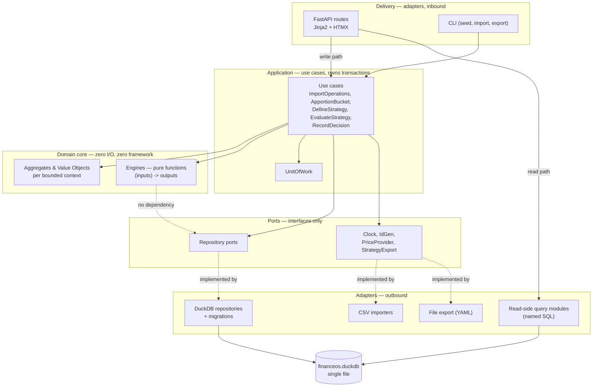
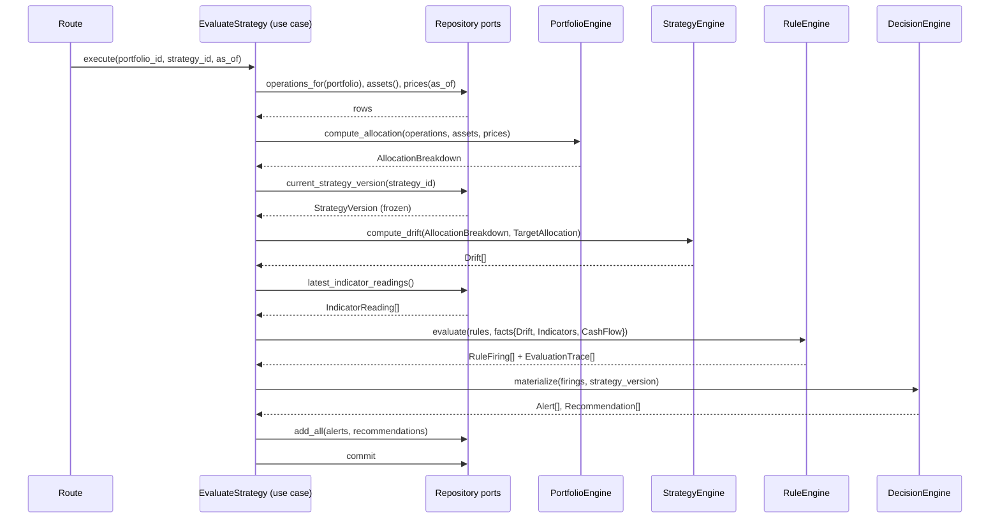

# RFC-0005 — Architecture & Walking Skeleton

| | |
|---|---|
| **Status** | Proposed |
| **Track** | Technical (0004–0010) |
| **Depends on** | RFC-0004 (Domain Model); RFC-0001/0002/0003 (frozen) |
| **Consumed by** | RFC-0006/0007/0008 (Engines), RFC-0009 (Data & Event Model), RFC-0010 (Roadmap) |
| **Resolves** | `STACK_POSTURE = recommend` |
| **Language** | English. Ubiquitous Language verbatim per RFC-0003. |

---

## 1. Context

RFC-0004 defines aggregates, invariants, and context contracts, and leaves three things unspecified that block construction: where code lives, how the eight Domain Services compose without touching storage (I-7), and what the stack is.

Two constraints from the brief dominate every choice below:

- **Shortest path to a working end-to-end V1 slice.** Documentation exists to unblock building.
- **P3 + P7 structurally**, not by convention. The provenance chain must be a property of the architecture.

Two decisions taken in dialogue and recorded here as ADRs: the **Rule Engine ships in V1** (diverging from RFC-0001's roadmap, which places it in V2 — RFC-0010 reconciles), and consequently the **`Decision` bounded context (RFC-0004 E1) ships in V1** rather than being a future concern.

---

## 2. Overall Shape: Hexagonal Write Side, Dataflow Read Side

The substantive architectural claim in this RFC: **Finance OS has two code shapes over one store**, and conflating them is the main way this project could go wrong.

- The **write side** is hexagonal. Aggregates, invariants, pure engines. Correctness matters more than throughput; the data volumes are trivial; the invariants are the product.
- The **read side** is a dataflow pipeline — SQL against DuckDB producing flat rows for templates. It never loads an aggregate.

Reads must bypass the domain because rendering an allocation page through aggregates would mean folding every `Operation` into `Holding`s in Python on every request. DuckDB does that in SQL in microseconds. Forcing reads through the domain buys nothing: **a read cannot violate an invariant.**

This is CQRS in the cheap sense only — no event bus, no second database, no eventual consistency. One DuckDB file, two access patterns, two code shapes.

> **Note on I-8.** "All mutations pass through the domain" is unviolated: the read path performs no mutations. The CI contract in §7 enforces that read-side query modules are imported only by the delivery layer, never by application services performing writes.



The dashed no-dependency edge from `ENG` to `REPO` is **I-7 made structural**: engines receive values and return values. There is no repository to inject.

---

## 3. How the Eight Domain Services Compose

RFC-0004 §4.1 modelled inter-context contracts as ports owned by the consuming context. **This RFC simplifies that**: in a single-process application, inter-context indirection buys nothing. The contracts survive as **DTO types**; the **application service is the composition point**.

So no engine calls another engine, and no context calls another context. A use case loads data through repository ports, calls engines in sequence passing DTOs, and persists the results. This is what makes I-7 true rather than aspirational.



Note the P7 mechanism visible in the wiring: the `StrategyVersion` is loaded **once**, frozen, and its id flows through every engine into the persisted `Provenance`. Nothing can drift mid-evaluation.

`DecisionEngine` is a **composition function**, not a ninth Domain Service (RFC-0004 §8): it takes firings, deduplicates, prioritizes, and materializes `Alert`/`Recommendation`. Detail in RFC-0008.

---

## 4. Package Structure

Bounded contexts map 1:1 onto packages.

```
src/financeos/
  core/                          # no I/O, no framework, no DB, no pandas
    shared/                      # Money, Quantity, Weight, ids, domain errors
    cashflow/                    # Account, Transaction, Category
    portfolio/                   # Asset, Operation, Portfolio, Bucket, VirtualHolding
    strategy/                    # Strategy, StrategyVersion, Rule, Goal, TargetAllocation
    market/                      # MarketIndicator, IndicatorReading
    decision/                    # Alert, Recommendation, Decision, Provenance
    engines/
      portfolio_engine.py        # allocation, holdings fold, valuation
      strategy_engine.py         # drift vs targets and tolerances
      rule_engine.py             # Condition evaluation + EvaluationTrace
      decision_engine.py         # dedup, prioritize, materialize
      cashflow_engine.py         # V1.1
  ports/                         # Protocol definitions only
    repositories.py
    market_data.py
    clock.py
    ids.py
    strategy_export.py
  app/                           # use cases; the only layer holding ports
    unit_of_work.py
    import_operations.py
    apportion_bucket.py
    import_strategy.py
    evaluate_strategy.py
    record_decision.py
  adapters/
    duckdb/
      connection.py
      migrations/               # 001_init.sql, 002_...
      repositories/
      queries/                  # READ SIDE — named SQL modules, see §5.3
    importers/                  # CSV → Operation DTOs
    files/                      # StrategyVersion → YAML export
    market/                     # PriceProvider implementations
  web/
    main.py
    routes/
    templates/
    static/
  cli.py
```

**Why `ports/` is a sibling of `core/` rather than inside it:** repository ports mention aggregate types, so `core` would have to import `ports` which imports `core`. Keeping ports separate makes the acyclic dependency mechanically checkable.

---

## 5. Stack Resolution

### 5.1 Language and domain core

**Python 3.12+**, with **Pydantic v2 frozen models** for value objects and aggregates (ADR-0006). `Decimal` throughout for monetary and quantity values; float is banned from the core.

Pydantic in the domain core is arguably a Manifest P8 violation and I want that on the record. It is a library, not a framework — no DB, web, or serialization coupling in the direction that matters — and it buys constructor validation, which is where a third of RFC-0004's invariants live. The counter-evidence is real: Pydantic's own v1→v2 migration was disruptive, which is precisely the churn P8 warns about. See ADR-0006 for the fallback.

### 5.2 Local store: DuckDB, single file

**One DuckDB file** at the platform data directory (`platformdirs`), e.g. `~/Library/Application Support/FinanceOS/financeos.duckdb` on macOS.

The full comparison against SQLite and against a lakehouse approach is in ADR-0005. The summary: at this data scale (~10³–10⁴ Transactions, ~10²–10³ Operations, ~10⁴–10⁵ readings over a decade) **the performance argument is irrelevant** — SQLite would be fast enough. DuckDB wins on **expressiveness in the queries this domain actually needs**, above all **ASOF joins** for valuing positions against the nearest-prior price, which is the single most frequent read-side query in the system and is genuinely painful in SQLite. A lakehouse table format is rejected outright: four orders of magnitude of scale mismatch, and a bulk-append write profile that is the opposite of this application's many-tiny-writes profile.

**No ORM.** Repositories hand-write SQL. An ORM would add mapping machinery to a domain that is already persistence-agnostic, and ORMs actively push toward loading object graphs, which fights the aggregate boundaries RFC-0004 established. Cost: more code, though mechanical and well-suited to agent-assisted development.

**Migrations:** numbered SQL scripts plus a `schema_version` table, applied on startup. Not Alembic — that's SQLAlchemy-coupled and we have no ORM.

> **Correction to RFC-0004 I-10.** RFC-0004 claimed append-only immutability could be enforced by withholding `UPDATE`/`DELETE` grants at the database level. **DuckDB has no per-table privilege system**, so that enforcement point does not exist. Revised enforcement: the repository port exposes no update or delete method for `Operation`, `Alert`, `Recommendation`, `StrategyVersion`, `IndicatorReading`, or `Snapshot`; a CI contract asserts no `UPDATE`/`DELETE` statement targets those tables anywhere in the codebase. This is weaker — it is enforced in the application, not the engine. A tamper-evident hash chain over append-only rows would restore real teeth; deferred as an open question, not built in V1.

**Snapshots live in a DuckDB table, not Parquet.** I originally proposed Parquet for the Snapshot series and am reversing that: at single-user volume it is one store versus two for no measurable benefit, which is exactly the gold-plating the brief forbids. Parquet becomes an **export feature** (`financeos export --parquet`) for external analysis in pandas or Polars, and the natural backup artifact. If Snapshot volume ever justifies partitioned Parquet, DuckDB reads it natively and the change is confined to one query module.

### 5.3 Read side

Analytical SQL lives **only** in `adapters/duckdb/queries/`, one module per view, each exposing a typed function. Never inline SQL in a route handler. Two reasons: DuckDB-specific constructs like ASOF joins are the least portable thing in the codebase, so confining them makes the store swappable by enumerating a directory rather than grepping; and it makes the read surface reviewable.

Query modules return **typed DTOs** (Pydantic, non-domain) for anything rendered as text or table. DataFrames appear only where feeding a chart or a numerical routine, and never cross into `app/` or `core/`.

Financial computation on the read side — XIRR, curve fitting — uses **PyXIRR** and SciPy. Do not hand-roll XIRR; the edge cases are miserable. These are read-side dependencies and must not appear in `core/`.

### 5.4 UI

**FastAPI + Jinja2 + HTMX**, charts via a JS charting library from a vendored static file. One process, one language, no build step, no npm (ADR-0007).

The decisive factor is that half of V1 is *write* flows — apportionment, Strategy editing, `Decision` capture — which need real forms with server-side validation and inline error rendering. Dashboard-first tools handle this badly.

Two properties matter more than they first appear:

- **Trace inspection is nearly free.** "Expand this Recommendation's provenance" is one HTMX attribute and one endpoint returning a fragment. The P3 user interface falls out of the architecture.
- **URL-addressability is arguably a domain requirement.** `/recommendations/{id}/trace` is a permalink into an audit artifact — bookmarkable, pasteable into a `Decision`'s rationale. Under P7 that is closer to load-bearing than cosmetic.

### 5.5 Process topology and ingestion

**Single process. No scheduler, no daemon** (ADR-0008). DuckDB permits one writer process per file, and the obvious background job — fetching prices and indicator readings — is a writer.

Ingestion is therefore a **user-triggered in-process action**. This is better than a cron job rather than merely cheaper: every ingestion becomes a timestamped, user-initiated, recorded act, whereas a silent 3am fetch that changes what a Rule would have fired on is precisely the kind of invisible state change ADR-0001 rejected. And nightly evaluation without a notification channel is just a stale dashboard.

V2 escape hatch, so this is not foreclosed: a fetcher writing only to a Parquet staging directory it owns exclusively, imported by the app on open. Never two writers on one file.

### 5.6 Strategy authoring and git

Strategies and Rules are authored **in the UI**; the DuckDB store is the single source of truth (ADR-0009). Git versioning is achieved asymmetrically:

- **DB → files, automatic.** Every `StrategyVersion` freeze also writes a canonical, deterministically-serialized `strategies/<slug>.yaml`. The file is a **derived artifact**; `StrategyVersion` remains the sole provenance anchor, so I-11 is untouched.
- **Files → DB, explicit and additive.** `financeos import-strategy <file>` creates a **new** `StrategyVersion`. External editing works *through* the audit trail rather than around it.

Git must not be the write path: it would make provenance resolve to a commit SHA, couple the core to a VCS (P8), and make `StrategyVersion` non-atomic with the surrounding transaction.

Footgun to mitigate: hand-editing the exported YAML without running `import-strategy` is silently ignored. The exporter writes a `# GENERATED — edit via 'financeos import-strategy'` header and a content checksum the importer verifies.

### 5.7 Packaging and privacy

Dev and run via **uv**; a `financeos` console script starts uvicorn and opens `localhost`. No installers, no Docker, no PyInstaller in V1 — a single-user local app run by its own author does not need distribution machinery.

Concrete Local First / Privacy First commitments, each testable:

| Principle | Mechanism |
|---|---|
| Local First | One file. Backup is `cp`. No account, no network dependency for any core function. |
| Privacy First | Zero telemetry. The only egress is the explicit market-data fetch. CI contract: no HTTP client may be imported anywhere under `core/` or `app/`. |
| Explainable | `EvaluationTrace` non-nullable (I-6); trace-replay property test; every Recommendation has a permalinked trace view. |
| Modular | Contexts as packages; import-linter contracts; engines as pure functions. |

---

## 6. Data Location and Layout

```
$DATA_DIR/FinanceOS/
  financeos.duckdb          # single source of truth
  strategies/               # derived YAML, git-managed by the user
    balanced-core.yaml
  imports/                  # raw CSVs, retained for re-import and audit
  exports/                  # parquet / csv on demand
```

Retaining raw import files is deliberate: if an importer has a bug, the fix is a re-import from an artifact that still exists. This costs nothing and is the cheapest possible insurance for the one class of error most likely to corrupt the `Operation` log.

Concrete schema is RFC-0009's job. **Nothing here forecloses ADR-0004** (decision-level reconstructability vs full event sourcing): `Operation` is append-only under both, and the split between append-only tables and derived read models is the same shape either way.

---

## 7. Enforcing the Architecture in CI

"Enforced by review" is not an enforcement point. `import-linter` contracts, run in CI:

| Contract | Rule |
|---|---|
| **C1 — core purity** | `financeos.core` must not import `financeos.adapters`, `financeos.web`, `financeos.app`, `duckdb`, `fastapi`, `pandas`, `polars`, `httpx`, `requests`. |
| **C2 — I-7 engines** | `financeos.core.engines` must not import `financeos.ports`. |
| **C3 — context isolation** | No `core.<context>` may import another `core.<context>`, except `core.shared`. |
| **C4 — read/write split** | `adapters.duckdb.queries` may be imported only by `financeos.web`, never by `financeos.app`. |
| **C5 — no egress in core** | No HTTP client importable from `core` or `app`. |
| **C6 — append-only** | Grep contract: no `UPDATE`/`DELETE` against append-only tables. |

Test layers:

- **Domain:** pure unit tests plus **Hypothesis** property tests for I-9 (conservation), I-13 (weights sum to 1), I-15 (currency mismatch), I-18 (acyclic categories).
- **P3 teeth:** a property test asserting that replaying an `EvaluationTrace` reproduces the recorded outcome. If this test cannot be written, I-6 is decorative.
- **Engines:** golden-file tests against a committed demo dataset with expected results — borrowed from Konty, the best idea in that repo.
- **Adapters:** integration tests against a temporary DuckDB file.

---

## 8. Walking Skeleton

The thinnest slice that exercises the entire spine: **import → fold → drift → rule → explainable recommendation → UI with inspectable trace.**

### 8.1 In scope

| Layer | Included |
|---|---|
| Aggregates | `Asset` (2, in 2 `AssetClass`es), `Operation` (~10, CSV import), `Portfolio` (1), `Bucket` (1), `Strategy` + `StrategyVersion` (1), `Rule` (1), `Alert`, `Recommendation` |
| Derived | `Holding` (fold), `AllocationBreakdown`, `Drift` |
| Engines | Portfolio (allocation + valuation), Strategy (drift vs tolerance), Rule (one `Condition` kind), Decision (materialize one Recommendation) |
| Prices | **Manual seed file.** No provider, no network — sidesteps market-data licensing entirely at this stage. |
| Store | DuckDB, migration `001_init.sql` |
| Web | 3 views: allocation, recommendations list, trace detail (HTMX fragment) |
| CLI | `seed`, `import-operations`, `import-strategy`, `evaluate`, `serve` |
| Tests | Demo dataset + committed expected results; trace-replay property test; C1/C2 contracts |

`Bucket` and `VirtualHolding` **are** in scope, with one Bucket holding 100% of both Assets. This is one extra table and one form, and it validates ADR-0001 — the riskiest domain decision in RFC-0004 — instead of discovering a problem with it three RFCs later. `UNASSIGNED` is exercised trivially at zero.

### 8.2 Explicitly out

- **Cash Flow entirely** — `Account`, `Transaction`, `Category`, Cash Flow Engine. The spine can be proven without it.
- `MarketIndicator` / `IndicatorReading` — the single Rule reads drift only.
- `Decision` capture — schema fixed in RFC-0004, UI deferred (per ADR-0002).
- `Snapshot`, Forecast, Tax, Knowledge, `Goal`.
- Multi-currency, real price providers, scenario/what-if evaluation, multi-rule dedup and prioritization, charts.
- **The Strategy editing UI.** The skeleton authors Strategy via `import-strategy` on a YAML file.

That last exclusion contradicts the "author in the UI" decision, and deliberately. Building a form-based Strategy editor — target allocation rows, tolerance bands, rule conditions — before the engine chain works would mean building the most speculative UI in the product against a Rule representation RFC-0006 has not yet finalized. File import first, editor immediately after RFC-0006 lands.

### 8.3 Definition of done

From a clean checkout:

```
uv run financeos seed demo
uv run financeos evaluate
uv run financeos serve
```

The recommendations view shows exactly one Recommendation reading approximately:

> *Equity/Developed is 6.0% below your target of 40.0% (tolerance ±2.0%). Current: 34.0%.*

Clicking it opens a trace showing the pinned `strategy_version` id, the `rule` id, every bound input value, the intermediate drift computation, and the outcome — and every number matches `demo/expected/`.

Note what this output is **not**: it names no instrument and prescribes no action. I-12 makes that structural — there is no field to put "buy VWCE" into.

### 8.4 First tasks, in order

1. `uv` project scaffold, `pyproject.toml`, ruff + mypy strict, import-linter with C1 and C2 only.
2. `core/shared`: `Money`, `Quantity`, `Weight`, `Percentage`, id types, domain errors. Property tests for I-15.
3. `core/portfolio`: `Asset`, `Operation`, `Portfolio`, `Bucket`, `VirtualHolding`. Property test for I-9.
4. `core/strategy`: `TargetAllocation` (I-13), `Tolerance`, `Rule`, `Strategy`, `StrategyVersion` with freeze-on-write and the empty-rule-set rejection (I-4).
5. `core/decision`: `EvaluationTrace`, `Provenance`, `Alert`, `Recommendation` — all frozen, all with non-nullable trace/provenance (I-5, I-6, I-11, I-12).
6. `PortfolioEngine.compute_allocation` as a pure function. Unit tests from hand-computed fixtures.
7. `StrategyEngine.compute_drift` as a pure function.
8. `RuleEngine.evaluate` for one `Condition` kind (`drift_outside_tolerance`), emitting `EvaluationTrace`. **Write the trace-replay property test here** — before any persistence exists.
9. `DecisionEngine.materialize`: firing → `Alert` → `Recommendation`.
10. `ports/repositories.py`, then `adapters/duckdb`: connection, `001_init.sql`, migration runner, repositories for the seven aggregates in scope.
11. `app/`: `UnitOfWork`, `import_operations`, `import_strategy`, `apportion_bucket`, `evaluate_strategy`. Wire the §3 sequence.
12. `demo/`: seed CSVs, `strategy.yaml`, prices, and `expected/` results. Golden-file test.
13. `web/`: FastAPI app, three views, HTMX trace fragment.
14. `cli.py`: the five commands. Add contracts C3–C6 to CI.

Steps 1–9 have no database and no web framework. That ordering is deliberate: if the domain and the trace mechanism are wrong, everything after is wasted, and steps 1–9 are where P3 and P7 are actually won or lost.

---

## 9. Consequences

**Positive**

- Steps 1–9 are pure Python with no infrastructure, so the riskiest part of the design is validated first and fastest.
- I-7 holds structurally: engines have no repository to inject, and C2 fails the build if one appears.
- One file, one process, one language. Backup is `cp`. Local First and Privacy First are properties of the deployment shape, not features to maintain.
- The read/write split means the analytical work Konty does well is available without letting DataFrames into the domain.
- The whole stack is agent-friendly: hand-written SQL repositories and HTMX fragments are small, independently testable units.

**Negative / accepted costs**

- **No ORM means writing repository SQL by hand** for ~15 aggregates. Mechanical, but real volume.
- **DuckDB weakens I-10.** Append-only immutability is now enforced in the application layer plus CI, not by the engine. This is a genuine reduction in guarantee versus what RFC-0004 claimed, disclosed in §5.2.
- **One writer process** is a hard constraint that shapes V2 ingestion, not a preference.
- **Pydantic in the core** is a defensible-but-real compromise on P8 (ADR-0006).
- **HTML and CSS by hand.** Mitigated by agent-assisted development, but the taste burden stays with the author.
- Two code shapes means a reviewer must know which side they are on. C4 makes the boundary mechanical, but it is a real cognitive cost that a single-shape architecture would not have.

---

## 10. Open Questions

1. **ADR-0004 remains open** and is the last blocking decision: decision-level reconstructability vs full event sourcing. RFC-0009 owns it. Nothing in this RFC forecloses either.
2. **Price data source beyond manual entry.** The skeleton avoids this deliberately. Whatever is chosen needs its licence recorded in the ADR, since it is the single biggest constraint on any future commercialization.
3. **Tamper-evidence for append-only tables.** Is a hash chain worth ~50 lines to restore what DuckDB's lack of grants removed? Leaning yes, in V1.1.
4. **Chart library.** Deferred until charts exist; both ECharts and Plotly.js are vendorable static files, and nothing depends on the choice.
5. **Migration testing.** With a solo evolving schema, is a forward-only migration list plus a rebuild-from-imports path sufficient, or is a tested down-migration needed? Leaning forward-only, given raw imports are retained (§6).
6. **Multi-currency** still deferred; V1 assumes one reporting currency (RFC-0004 §10.5).

---

## Appendix A — ADR Index (cumulative)

| ADR | Title | Status | Owner RFC |
|---|---|---|---|
| ADR-0001 | Bucket apportionment model | Accepted | RFC-0004 |
| ADR-0002 | Definition of `Decision` | Accepted | RFC-0004 |
| ADR-0003 | `Holding` as derived read model | Accepted | RFC-0004 |
| ADR-0004 | Scope of reconstructability | **Open** | RFC-0009 |
| ADR-0005 | Local store: DuckDB single file | Accepted | RFC-0005 |
| ADR-0006 | Pydantic v2 in the domain core | Accepted | RFC-0005 |
| ADR-0007 | UI: FastAPI + Jinja2 + HTMX | Accepted | RFC-0005 |
| ADR-0008 | Single process, on-demand ingestion | Accepted | RFC-0005 |
| ADR-0009 | Strategy files as derived artifacts | Accepted | RFC-0005 |
| ADR-0010 | Defer commercialization posture | Accepted | RFC-0005 |

---

### ADR-0005 — Local store: DuckDB single file

**Context.** Finance OS is local-first and single-user, with a write profile of many tiny transactional writes and a read profile that is strongly analytical: time-series valuation, drift over time, allocation aggregation, series for forecasting.

**Decision Drivers.** Local First (a file, not a service); shortest path to V1; expressiveness for time-series valuation; author's existing familiarity; reversibility behind repository ports.

**Considered Options.**
1. *SQLite* — maximally battle-tested transactional embedded store.
2. *DuckDB* — embedded OLAP, single file, native Parquet and Arrow.
3. *PostgreSQL* — as in Konty.
4. *Lakehouse* — Iceberg or Delta over Parquet with a catalog.
5. *SQLite for writes + DuckDB for reads.*

**Decision Outcome.** Option 2.

Option 4 is rejected outright: roughly four orders of magnitude of scale mismatch (single-digit MB versus the millions of files table formats exist to manage), and a bulk-append write profile that is the inverse of this application's. It would import small-file compaction as a chore in exchange for nothing.

Option 3 requires a daemon, a port, a user, and `pg_dump` where a file copy would do — a real operational tax against Local First, with no benefit at this scale.

Option 1 is the serious contender and would be fast enough; the performance argument for DuckDB is close to irrelevant here. It loses on **expressiveness where the domain is richest**: valuing a `Holding` requires joining each position to its nearest-prior price, which is a native ASOF join in DuckDB and a correlated-subquery exercise in SQLite. That query is the most frequent on the read side. Window functions, `LIST`/`STRUCT` types for storing an `EvaluationTrace` without shredding it, and zero-copy Arrow interop compound the gap.

Option 5 is architecturally tidier and rejected as gold-plating: two stores means two migration paths and a staleness question, which is meaningful tax on a solo prototype.

**Consequences.** One writer process per file — this constrains V2 ingestion topology (ADR-0008) and is the main accepted cost. No per-table privileges, which weakens I-10 (§5.2). Migration ergonomics are less battle-worn than SQLite's, mitigated by retaining raw imports so a rebuild is always possible. Reversible: the store sits behind repository ports and named query modules.

---

### ADR-0006 — Pydantic v2 in the domain core

**Context.** RFC-0004 places ~8 invariants in value-object and aggregate constructors. Manifest P8 says the domain must outlive frameworks.

**Decision Drivers.** Constructor validation where invariants live; immutability; developer familiarity; P8; serialization needed at the boundary regardless.

**Considered Options.**
1. *Frozen `dataclasses` + hand-written `__post_init__` validation* — zero dependencies, purest reading of P8.
2. *Pydantic v2 frozen models.*
3. *`attrs` with validators.*

**Decision Outcome.** Option 2. Pydantic is a library, not a framework: no DB, web, or ORM coupling. It provides exactly the constructor validation that a third of RFC-0004's invariants require, plus the boundary serialization needed anyway.

The honest counter-argument is that Pydantic's v1→v2 migration was genuinely disruptive, which is precisely the churn P8 warns against — so this decision has already been falsified once in the wild.

**Consequences.** The core carries one third-party dependency. Mitigation, and the reason this is low-risk: validation is confined to constructors and `model_validator` methods, so migrating to Option 1 is a mechanical, well-localized change rather than a redesign. `Decimal` handling must be configured explicitly, since Pydantic's coercion defaults are not what a financial domain wants.

---

### ADR-0007 — UI: FastAPI + Jinja2 + HTMX

**Context.** V1 needs both an analytical read surface and real write flows: apportionment, Strategy editing, `Decision` capture. Trace inspection is a first-class requirement (P3).

**Decision Drivers.** Write-flow quality; trace inspection ergonomics; permalinkability under P7; no build step; single language; author dislikes Streamlit; development is agent-assisted.

**Considered Options.**
1. *Streamlit.*
2. *FastAPI + Jinja2 + HTMX.*
3. *NiceGUI.*
4. *FastAPI + SPA (React/Svelte).*
5. *Textual TUI.*

**Decision Outcome.** Option 2.

Option 1 is rejected on substance as well as preference: the whole-script rerun model handles validated forms badly, and it cannot give URL-addressable trace views. Under P7, a permalink into an audit artifact — bookmarkable, pasteable into a `Decision`'s rationale — is closer to a domain requirement than a convenience.

Option 4 adds npm, a build step, and a second language for a single-user local app. Option 5 loses on the inherently visual Reporting pillar. Option 3 is the credible alternative — Python-only, genuinely stateful, handles forms properly — and would be the right call if the author refused to write HTML; it trades away permalinking and layout control.

Agent-assisted development strengthens Option 2 specifically: HTMX's unit of work is a small server-rendered fragment behind one endpoint, which is close to ideal for generation and review.

**Consequences.** HTML and CSS are written by hand. HTMX is a new paradigm, though a small one. Charting becomes a separate decision. In exchange: server-side Pydantic validation with inline errors, trace inspection as a one-attribute lazy fragment, and the only presentation choice that survives a commercialization pivot intact.

---

### ADR-0008 — Single process, on-demand ingestion

**Context.** DuckDB permits one writer process per database file. The natural background job — fetching prices and indicator readings — is a writer.

**Decision Drivers.** DuckDB's single-writer constraint; P7 auditability of state change; absence of any notification channel in V1; not foreclosing V2 scheduling.

**Considered Options.**
1. *Single process; ingestion as a user-triggered in-process action.*
2. *Separate scheduled fetcher writing the same file.*
3. *Fetcher writing a staging area the app imports.*

**Decision Outcome.** Option 1 for V1. Option 2 conflicts directly with the store's write model. Option 3 works and is the V2 path, but is unnecessary machinery now.

Beyond cost, Option 1 is better on P7 grounds: every ingestion becomes a timestamped, user-initiated, recorded act. A silent overnight fetch that changes what a Rule would have fired on is the same class of invisible, uncaused state change that ADR-0001 rejected for weight-based apportionment. And nightly evaluation without a notification channel produces only a stale dashboard.

**Consequences.** Fetching happens when the user asks, so data can be stale between sessions — acceptable for a DSS consulted weekly, unacceptable for anything alert-driven, which V1 is not. Long fetches block a request; mitigated with an HTMX polling fragment rather than a worker. Option 3 remains available unchanged.

---

### ADR-0009 — Strategy files as derived artifacts

**Context.** Strategies and Rules are authored in the UI, but the author wants git versioning of strategy evolution.

**Decision Drivers.** P7 provenance integrity (I-11); P8 (no VCS coupling in the core); human-readable diffs of strategy evolution; text backup independent of DB format.

**Considered Options.**
1. *Files are the source of truth; DB is a cache.*
2. *DB is the source of truth; files are auto-exported derived artifacts; import creates a new version.*
3. *No file representation at all.*

**Decision Outcome.** Option 2. Option 1 would make provenance resolve to a commit SHA, require `git checkout` to reconstruct a past evaluation, couple the core to a VCS in violation of P8, and make `StrategyVersion` writes non-atomic with the surrounding transaction. Option 3 forfeits genuinely valuable history — "how did my thinking change over three years?" is a question the Manifest implies and nothing else in the system answers.

**Consequences.** Every freeze writes a file, so serialization must be canonical and deterministic or git diffs become noise. Hand-editing an exported file without running `import-strategy` is silently ignored — mitigated by a `# GENERATED` header and a checksum the importer verifies. The DuckDB file itself is *not* git-managed: binary, no useful diffs, repository bloat.

---

### ADR-0010 — Defer commercialization posture

**Context.** Finance OS is built for personal use, with possible commercialization later.

**Decision Drivers.** Shortest path to V1; avoiding speculative generality; keeping the option genuinely open rather than pre-paid.

**Considered Options.**
1. *Build multi-tenant-ready from the start.*
2. *Build strictly single-user; accept a shell rewrite if commercializing.*
3. *Partial hedging — abstract storage location, add a nullable tenant id.*

**Decision Outcome.** Option 2. The domain core survives a pivot intact, which is P8's payoff. Everything around it — persistence, identity, tenancy, deployment, backup, other people's data — is a rewrite regardless, because "the user's data lives on the user's disk" is an architectural assumption, not a configuration flag. Option 3 pays real cost for a hedge that covers a small fraction of the actual work.

Five things are pre-paid because each is justified on V1 merits alone: analytical SQL confined to named query modules (§5.3); use cases as explicit single-entry functions; market data behind a port with its licence recorded; clock and id generation behind ports; dependency-licence hygiene, since an AGPL dependency in the core would foreclose options silently.

**Consequences.** Commercializing means rewriting the persistence adapter, the ingestion topology, and adding identity, tenancy, and billing from nothing. The presentation layer and domain core survive. Two non-engineering constraints would dominate anyway and are recorded here so they are not rediscovered late: **market-data licensing** (personal use is not redistribution, and most accessible feeds prohibit the latter), and the fact that under MiFID II a *personal recommendation on a specific instrument presented as suitable* is a regulated activity — which I-12 already makes structurally unrepresentable, converting a philosophical constraint into a regulatory asset.
