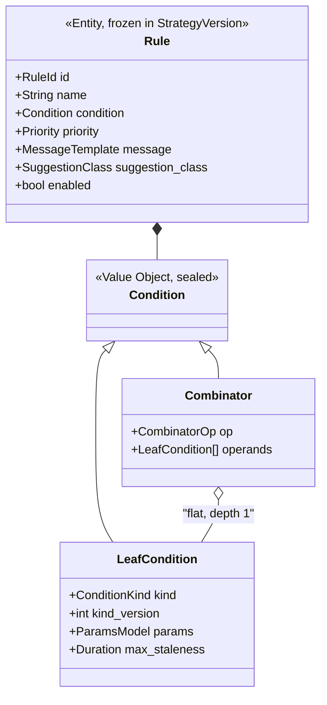
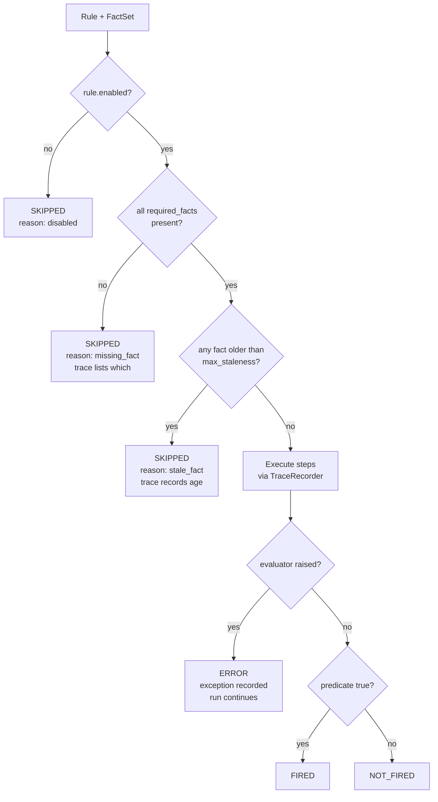
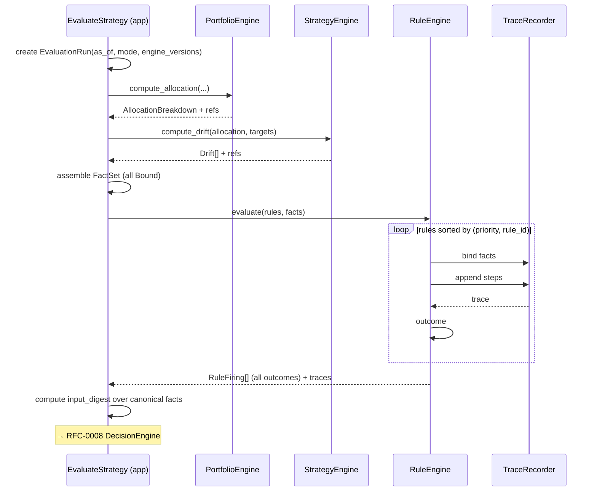

# RFC-0006 — Rule Engine

| | |
|---|---|
| **Status** | Proposed |
| **Track** | Technical (0004–0010) |
| **Depends on** | RFC-0004 (Domain Model), RFC-0005 (Architecture), RFC-0009 (Trace schema) |
| **Consumed by** | RFC-0007 (Strategy Engine), RFC-0008 (Decision Engine), RFC-0010 (Roadmap) |
| **Defines** | `Condition` representation, the condition catalog, evaluation lifecycle, outcome taxonomy |
| **Language** | English. Ubiquitous Language verbatim per RFC-0003. |

---

## 1. Context

RFC-0003 defines a `Rule` as a five-part chain: Condizione → Valutazione → Messaggio → Priorità → Suggerimento. RFC-0004 classified `Condition` as a "declarative predicate AST" and made `Rule` a child entity of the immutable `StrategyVersion`. RFC-0009 fixed the `EvaluationTrace` schema and, critically, the **replay contract**:

> Given `condition` plus the `value` of every binding, and ignoring all `source` fields, re-executing `steps` must reproduce `outcome` exactly.

That contract is the design constraint for this entire RFC. It rules out the obvious implementations and forces the one below.

Two properties are non-negotiable and everything else follows from them:

- **P3** — every firing explainable in domain terms, not in evaluator terms.
- **I-6** — `EvaluationTrace` is non-nullable, and replay must reproduce the outcome.

---

## 2. Representation: A Closed Catalog, Not a Language

**Decision (ADR-0014): `Condition` is a closed, versioned catalog of typed predicate kinds. Not a general expression language, not Python callables, not a third-party rules library.**

The tempting design is a general expression language — JsonLogic, CEL, a mini-Python, a SQL predicate. Each is rejected, and the reason is not implementation cost:

**A general language makes the trace algebra unbounded.** Every operator needs a replay implementation and a canonical serialization. The `steps` vocabulary grows to the size of the language, and the replay property test becomes a language conformance suite.

**Worse, a general language permits conditions that are technically traceable and humanly unexplainable.** `(a > b) and (c < d or e != f)` produces a complete, correct trace that reads like a stack dump. The Manifest does not ask for determinism, it asks for *explanation*: "l'allocazione è fuori target del 6%", not "expression node 7 evaluated false". Explanation in domain terms requires the evaluator to *know what the predicate means*, which a general expression evaluator by construction does not.

So each `Condition` kind is a first-class, named domain concept carrying four things:

| Component | Purpose |
|---|---|
| `kind` + `kind_version` | Stable identifier recorded in every trace |
| `params` model (Pydantic) | Validated at authoring time, not evaluation time |
| `required_facts` declaration | Drives the `SKIPPED` path (§5) |
| `evaluate(params, facts, recorder)` | Pure; emits `steps`, `outcome`, and `severity` |
| `severity` | Dimensionless breach ratio, or explicit `null`. Defined in RFC-0007 §3.1; consumed by RFC-0008 for ordering within a `Priority` band. |
| Explanation template | Renders in domain terms from captured bindings |

Adding a condition kind is a code change. **For this project that is a feature, not a cost**: the author is the developer, agent-assisted development makes each kind a small well-specified unit, and — decisively — every new kind arrives with its own replay test. A user-facing rule builder would require the general language and would reopen every problem above; ADR-0010 already accepts that as part of the commercialization rewrite.

### 2.1 Composition: exactly one level

Leaf conditions may be wrapped in one combinator — `all_of`, `any_of`, or `not` — over a flat list. **Nested combinators are rejected by the schema.**

This covers the realistic cases ("drift breached AND credit spread elevated") while keeping every trace readable: each leaf explains itself, the combinator explains the conjunction. The depth limit is mechanically enforceable in the params model.

The heuristic behind the limit: *if a rule needs deeper nesting, it is really two rules.* Two rules produce two explanations and two independently-tunable priorities, which is almost always what was actually wanted.



---

## 3. The Condition Catalog

`scope` is always a `Bucket` or the whole `Portfolio`. Availability column: **S** = walking skeleton, **1** = V1, **1.1** = follow-on.

| Kind | Params | Facts consumed | Avail |
|---|---|---|---|
| `drift_outside_tolerance` | `asset_class`, `scope` | `targets`, `allocation`, `drift` | **S** |
| `allocation_absent` | `asset_class`, `scope` | `targets`, `allocation` | 1 |
| `untargeted_allocation` | `scope`, `threshold_weight` | `targets`, `allocation` | 1 |
| `unassigned_residual_above` | `threshold_weight` | `residual` | 1 |
| `concentration_above` | `scope`, `threshold_weight` | `allocation` (per-asset) | 1 |
| `indicator_threshold` | `indicator_id`, `comparator`, `value` | `indicators` | 1 |
| `bucket_below_target_value` | `bucket`, `target: Money` | `allocation`, `prices` | 1 |
| `emergency_cover_below_months` | `bucket`, `months` | `allocation`, `cashflow.run_rate` | 1.1 |
| `savings_rate_below` | `threshold`, `period` | `cashflow` | 1.1 |
| `indicator_percentile` | `indicator_id`, `percentile`, `lookback` | `indicators` + history | 1.1 |
| `goal_funding_gap` | `goal`, `threshold` | `goals`, `allocation` | V2 |

Three entries earn their place for non-obvious reasons.

`untargeted_allocation` is required by RFC-0007 §4.2, not optional. Under ADR-0012's correction model, reclassifying an `Asset` into a class the governing `StrategyVersion` does not target is a likely event — it is precisely the state RFC-0009 §2.2's Reconcile example produces. Untargeted holdings stay in the denominator, so without this kind the only symptom is a scattering of small spurious under-allocation findings across every *other* class, and the actual cause is invisible.

`unassigned_residual_above` exists because ADR-0001 made apportionment a manual act and I-9 exposes an `UNASSIGNED` residual. Without this rule, unapportioned capital is a silent gap in every drift computation. Making it a Rule means the system surfaces its own maintenance chore through the same explainable channel as everything else, rather than through a special-case warning banner.

`emergency_cover_below_months` is the first condition that spans two bounded contexts — Portfolio value against Cash Flow run rate. It is the clearest demonstration that the Rule Engine consumes *facts*, not contexts, and it is worth building early in V1.1 as a shape test even though Cash Flow is out of the skeleton.

### 3.1 What the Rule Engine does not compute

`drift` is a fact, supplied by the Strategy Engine (RFC-0007). Allocation and valuation are facts, supplied by the Portfolio Engine. **The Rule Engine performs no financial computation** — it evaluates predicates over supplied values and records how it did so. This boundary is what keeps `steps` a small algebra rather than a numerical library.

`severity` follows the same split. For drift conditions it arrives pre-computed as a `Bound` fact from the Strategy Engine, together with `effective_band`. For kinds with no Strategy-side notion of a band — `indicator_threshold`, `concentration_above` — the kind computes it from its own params through the recorder, so it lands in `steps` like any other value and stays replayable.

---

## 4. Facts: The Input Contract

`RuleEngine.evaluate` receives a frozen, fully-materialized `FactSet`. No lazy loading is possible — engines hold no repository (I-7) — so the application service assembles everything first (RFC-0005 §3).

```python
class Bound[T]:                      # frozen
    value: T                         # what Stage A replays
    source: SourceRef                # what Stage B resolves
    observed_at: datetime | None      # staleness input

class FactSet:                       # frozen
    as_of: date
    scope: PortfolioId | BucketId
    targets:    Mapping[AssetClass, Bound[TargetLine]]
    allocation: Mapping[AssetClass, Bound[AllocationLine]]
    per_asset:  Mapping[AssetId, Bound[Quantity]]     # concentration only
    drift:      Mapping[AssetClass, Bound[Decimal]]
    indicators: Mapping[IndicatorId, Bound[Decimal]]
    residual:   Bound[Weight] | None
    cashflow:   Bound[CashFlowView] | None
```

**Every fact is a `Bound` — value plus source ref plus observation time.** This is the mechanism that makes the trace unavoidable rather than diligent:

> **The trace is not emitted. It is accumulated.**

A `TraceRecorder` is threaded through evaluation. Reading a fact appends a binding; every arithmetic step goes through `recorder.subtract(...)`, `recorder.abs_gt(...)` and appends a step. **There is no code path that evaluates without producing a trace**, because the values being evaluated *are* the trace bindings. I-6 cannot decay into decoration, because decoration would require a second, untraced arithmetic path that does not exist.

The recorder is local mutable state returned as part of the output, so `evaluate(rules, facts) -> (firings, traces)` remains a pure function and C2 (no ports in engines) is untouched.

### 4.1 The step algebra

Deliberately tiny. Every operation is total, `Decimal`-exact, and trivially replayable:

`subtract` · `add` · `multiply` · `divide_safe` · `abs` · `gt` · `gte` · `lt` · `lte` · `eq` · `abs_gt` · `ratio_to` · `all` · `any` · `not`

`divide_safe` returns a `SKIPPED` marker on zero denominator rather than raising — a zero-value portfolio is a legitimate state during onboarding, not an error. Additions to this list require an ADR; the list growing is the signal that a general expression language is being reinvented by accident.

### 4.2 Market Indicators

Per RFC-0004's `IndicatorView` contract, an indicator fact binds `(value, reading_id, observed_at)`. Pinning `reading_id` is what makes Stage B able to answer "which exact reading did this fire on" after the series has been revised — and macro series *are* revised, which is why `indicator_reading` is bitemporal in RFC-0009 §2.1.

Indicators are read at their latest **recorded** value as of the run's `as_of`, never interpolated and never forward-filled beyond `max_staleness`. Forward-filling a stale inflation print into a live rule evaluation is exactly the kind of invented fact this architecture exists to prevent.

---

## 5. Outcomes: Four, Not Two

**Decision (ADR-0016): `SKIPPED` is a first-class outcome, distinct from `NOT_FIRED`.**

This is the most consequential correctness decision in this RFC. A rule that *could not be evaluated* must never be recorded as *not firing*. If a missing price silently produces `NOT_FIRED`, your portfolio looks compliant precisely when the system has least information about it — a failure mode that is both silent and inverted.



All four outcomes are persisted as `alert` rows (RFC-0009 §3.2, extension E5). Only `FIRED` surfaces in the recommendations list. `SKIPPED` and `ERROR` surface in a **run health panel** — because a strategy whose rules are quietly all skipping is a strategy that is not being enforced, and that is exactly the situation a user would never discover on their own.

**Staleness is a required feature, not a nicety.** ADR-0008 made ingestion user-triggered, so stale data is the *expected* state between sessions, not an anomaly. `max_staleness` per leaf condition is the direct consequence of that decision.

---

## 6. Evaluation Lifecycle



**Evaluation order is deterministic**: sorted by `(priority DESC, rule_id ASC)`. Not for correctness — rules are independent — but so that a re-run produces byte-identical output, which is what makes `input_digest` comparisons meaningful.

### 6.1 No forward chaining

**Decision (ADR-0015): rules are mutually independent. No rule reads another rule's outcome. There is no inference cycle, no agenda, no Rete network.**

Classical production-rule systems chain: a firing asserts a fact, which enables another rule. That is rejected here because it makes explanation *transitive* — answering "why did this fire" requires walking a derivation tree whose depth is data-dependent, and P3's promise degrades from a sentence to a proof. It also makes evaluation order semantically significant, so `input_digest` would have to cover the agenda.

The domain does not need it. Every V1 condition is a predicate over portfolio or market state, not over other conclusions. If a rule genuinely needs a derived intermediate, that intermediate belongs in the Strategy Engine as a *fact*, computed once and traced, not as a rule firing.

### 6.2 Hypothetical evaluation

Candidate-asset evaluation needs **nothing new here**. The application service builds a `FactSet` from real Operations plus a `ScenarioOperation` delta, sets `mode = HYPOTHETICAL` on the run, and calls the same engine. Purity is what makes this free: the Rule Engine cannot tell the difference and does not need to.

The only obligation lives outside the engine — RFC-0009 requires every read-side query to exclude `HYPOTHETICAL` runs by default, so a speculative firing can never reach the recommendations list.

---

## 7. Message and Suggestion

### 7.1 Messages render from the trace, not from live state

`MessageTemplate` is interpolated against `message_bindings` captured in the trace (RFC-0009 §4.1, property 4). Rendering a March message in October must read only the March trace. No template may reference anything outside its own captured bindings — enforced at authoring time, since the binding namespace of each condition kind is closed and known.

That closure does more work than it appears to. **For allocation and drift conditions, the binding namespace contains `AssetClass` but no `AssetId` or instrument name.** So it is not merely discouraged but *structurally impossible* to interpolate "VWCE" into a drift message: the binding does not exist to reference. This is I-14 supplying, as a side effect, the mechanism that keeps generated output instrument-free.

### 7.2 `SuggestionClass` is a closed enum (extension E7)

RFC-0003 leaves *Suggerimento* free-form. Free-form text is where I-12 would leak, so the suggestion becomes a closed enum and the prose attaches to the class:

`REVIEW_ALLOCATION` · `CONSIDER_REBALANCE` · `REVIEW_BUCKET_ASSIGNMENT` · `REVIEW_STRATEGY` · `REVIEW_LIQUIDITY` · `NO_ACTION`

Every member names a *category of deliberation*, never a transaction. There is no member that could carry an instrument, a direction, or a size — which is I-12 and the ADR-0010 regulatory firewall enforced in the type system rather than in review.

**One honest limit.** `MessageTemplate` prose is authored by the user. Finance OS does not police what its author writes in their own strategy; if you type a prescription into a template, it will render. What is enforced is that the *system* never generates one, and that the schema has no field to hold one. Constraining author-written templates would only matter under commercialization, where ADR-0010 already accepts a rewrite.

---

## 8. Versioning

Three independent axes, frequently conflated:

| Axis | Mechanism | Consequence |
|---|---|---|
| **Rule definition** | Frozen inside `StrategyVersion`. No separate rule version. | `rule_id` is **stable across versions**; `(strategy_version_id, rule_id)` identifies one frozen definition. This is what makes "how has this rule's firing history evolved?" answerable. |
| **Condition kind semantics** | `kind_version` in every leaf and in every trace. | See the rule below. |
| **Engine implementation** | `engine_versions` JSON on `evaluation_run` (RFC-0009 §3.2). | Explains a replay discrepancy caused by an evaluator fix rather than a data change. |

**The rule that keeps this cheap: never change a kind's semantics. Introduce a new kind.** `drift_outside_tolerance` v1 evaluates identically forever; if the definition of drift changes, `drift_outside_tolerance_v2` is registered and the old evaluator is retained. This is the same discipline as `trace_version` in RFC-0009 §7.2, and it accumulates the same narrow, bounded tax: a handful of frozen evaluators, not an upcasting framework.

Deprecated kinds stay registered and evaluable but are hidden from the authoring UI.

---

## 9. Authoring Representation

Per ADR-0009 the UI is the write path and YAML is a derived artifact. Both serialize the same Pydantic model, so the YAML is exactly what the authoring form produces.

```yaml
# GENERATED — edit via 'financeos import-strategy'
rules:
  - id: 019460a1-7c3e-7f2a-9b41-2d8e5f0a1c33   # stable across versions
    name: Equity developed under target
    enabled: true
    priority: HIGH
    suggestion_class: CONSIDER_REBALANCE
    message: >-
      {asset_class_label} is {drift_pct}% from your target of {target_pct}%
      (tolerance ±{tolerance_pct}%). Current: {current_pct}%.
    condition:
      kind: drift_outside_tolerance
      kind_version: 1
      max_staleness: P7D
      params:
        asset_class: EQUITY_DEVELOPED
        scope: bucket:019460a1-7c3e-7f2a-9b41-000000000001

  - id: 019460a1-7c3e-7f2a-9b41-2d8e5f0a1c34
    name: Equity under target while spreads elevated
    priority: MEDIUM
    suggestion_class: REVIEW_ALLOCATION
    message: >-
      {asset_class_label} is below target while credit spreads are elevated
      ({indicator_value}bp vs {indicator_threshold}bp).
    condition:
      op: all_of                    # depth 1 — operands must be leaves
      operands:
        - kind: drift_outside_tolerance
          kind_version: 1
          params: { asset_class: EQUITY_DEVELOPED, scope: portfolio }
        - kind: indicator_threshold
          kind_version: 1
          max_staleness: P31D
          params: { indicator_id: CREDIT_SPREAD_IG_EUR, comparator: gte, value: "150" }
```

Note `max_staleness` differs per leaf: a price may be a week old, an inflation print a month. Uniform staleness would be wrong in both directions.

---

## 10. Canonicalization and Determinism

`input_digest` (RFC-0009 §3.2) is only meaningful if serialization is byte-stable. The rules, which apply to both the digest input and the stored trace:

1. `Decimal` serializes as a string at the scale declared by its VO — `"0.4000"`, never `0.4`.
2. Mapping keys sort lexicographically; `bindings` and `steps` keep insertion order, which is evaluation order.
3. Timestamps are UTC RFC 3339 with explicit offset.
4. `null` is omitted rather than emitted, so absence has one representation.
5. `input_digest` = SHA-256 over the canonical form of `(condition, all bound values, as_of)` — **excluding** `source` refs and `observed_at`, so re-fetching an unchanged price does not alter the digest.

Rule 5 is the subtle one: the digest must answer "would this evaluate the same?", not "has anything been re-recorded?".

---

## 11. Testing

| Layer | Test |
|---|---|
| Per kind | Hand-computed fixtures, including boundary cases at exactly `±tolerance`. |
| **Replay** | Hypothesis property: for arbitrary `FactSet`, replaying `steps` over recorded `value`s reproduces `outcome`. Runs against **every** registered kind. |
| **Determinism** | Same `FactSet` twice → byte-identical trace and digest. |
| **Registry completeness** | A kind cannot be registered without params model, evaluator, explanation template, `required_facts`, and a `severity` declaration (a formula or an explicit `null`). Fails the build otherwise. |
| Severity | Per RFC-0007 §3.1: `severity == 1` exactly at the band, monotonic in `\|drift\|`. |
| Skip paths | Missing fact, stale fact, disabled rule, zero denominator each produce `SKIPPED` with the correct reason — never `NOT_FIRED`. |
| Combinator | Depth-2 nesting is rejected by the params model. |

The registry completeness test is the mechanical guard that stops the catalog from decaying: it is the only thing preventing a kind from shipping with a working evaluator and no explanation, which is precisely how a P3 system quietly stops being explainable.

---

## 12. Walking Skeleton Slice

Per RFC-0005 §8, one kind: `drift_outside_tolerance`, `kind_version: 1`.

- No combinators, no indicators, no cash flow, no staleness (seeded prices are same-day).
- `SKIPPED` paths implemented anyway — missing target and zero portfolio value are reachable from an empty seed, and retrofitting the outcome taxonomy later would mean rewriting stored traces.
- The replay property test lands at skeleton task 8, **before persistence exists**. If it cannot be written there, the trace schema is wrong and everything downstream is wasted.

---

## 13. Consequences

**Positive**

- The trace is a byproduct of evaluation rather than an obligation, so I-6 cannot silently decay.
- Explanations are in domain terms because each kind knows its own meaning — unavailable to any general expression evaluator.
- The step algebra is small enough that replay is genuinely mechanical.
- Independence of rules keeps every explanation one level deep.
- Hypothetical evaluation required no new machinery.
- `SKIPPED` prevents the worst silent failure available to this system.

**Negative / accepted costs**

- **New condition kinds are code changes.** Acceptable while author and developer are the same person; a blocker for any product with a rule builder.
- **Depth-1 composition will occasionally feel restrictive.** The mitigation — split into two rules — changes rule count and therefore the dedup surface RFC-0008 must handle.
- **Deprecated kind evaluators accumulate forever**, like `trace_version` readers. Bounded but non-zero.
- **`SuggestionClass` as a closed enum is less expressive** than RFC-0003's free-form *Suggerimento*, and requires product ratification (E7).
- **`max_staleness` per leaf is another authoring decision** the user must make, with a bad default in either direction.
- Storing `SKIPPED` and `NOT_FIRED` grows `alert` with rules × runs (RFC-0009 §9).

---

## 14. Open Questions

1. ~~**Static vs dynamic priority.**~~ **Resolved.** `Priority` stays static as the Rule attribute RFC-0003 declares, and RFC-0008 orders *within* each band by `severity` (RFC-0007 §3.1) descending, `rule_id` ascending as a stable tiebreak. Kinds emitting `severity = null` sort last within their band.
2. **E7 ratification** — does the product track accept `SuggestionClass` as a closed enum in place of free-form *Suggerimento*?
3. **Per-rule scope resolution.** A rule is written against one `Bucket` or the `Portfolio`. Should a rule be expressible as "every Bucket governed by this Strategy", expanding at evaluation time? Convenient, but it makes `rule_id` no longer identify one firing per run, which complicates dedup. Leaning explicit, one rule per scope, until it hurts.
4. **`indicator_percentile` needs history inside a pure engine.** Passing a full lookback series as a fact is consistent but bulky in every trace. Alternative: pass the pre-computed percentile as a single derived `Bound` with the series ids in `source`. Leaning the latter; it belongs to RFC-0007's fact-assembly responsibility.
5. ~~**Tolerance semantics on `RELATIVE`.**~~ **Resolved by ADR-0018.** Both kinds are retained with distinct meanings: `ABSOLUTE(band)` is ±band in percentage points; `RELATIVE(band)` is ±(band × effective_target). `drift_outside_tolerance` computes `effective_band` per kind and emits it as a binding, so the trace records which semantics applied.
6. **Rule-level test harness for the user.** "Would this rule have fired over the last 12 months?" is a HYPOTHETICAL run per historical Snapshot. Cheap given the design, and genuinely useful for tuning — but it is a backtest, and §the ADR-0010 caution about backtests designed after seeing the data applies to rule tuning just as much as to strategy selection.

---

## Appendix A — ADR Index (cumulative additions)

| ADR | Title | Status | Owner RFC |
|---|---|---|---|
| ADR-0001…0013 | *(see RFC-0004, 0005, 0009)* | Accepted | — |
| ADR-0014 | Conditions as a closed typed catalog | Accepted | RFC-0006 |
| ADR-0015 | No forward chaining | Accepted | RFC-0006 |
| ADR-0016 | `SKIPPED` distinct from `NOT_FIRED` | Accepted | RFC-0006 |

---

### ADR-0014 — Conditions as a closed typed catalog

**Context.** `Condition` must be declarative data (rules-as-data, versioned inside `StrategyVersion`) and must compile to RFC-0009's explicit `steps` algebra so replay is mechanical.

**Decision Drivers.** P3 explanation in domain terms; the replay contract; bounded trace vocabulary; authoring validation; solo maintenance cost.

**Considered Options.**
1. *Python callables* — maximum expressiveness.
2. *General expression language* — JsonLogic, CEL, or a custom mini-language.
3. *Closed catalog of typed kinds*, with depth-1 boolean composition.
4. *Third-party rules engine* — production-rule library with chaining.
5. *SQL predicates* against the read side.

**Decision Outcome.** Option 3.

Option 1 cannot satisfy the replay contract: a lambda's trace is whatever the author remembered to record, and it puts executable code inside a frozen audit artifact. Option 2 makes the `steps` vocabulary unbounded and, more damagingly, permits conditions that are traceable but unexplainable — a general evaluator does not know what its predicate *means*, so it cannot render "l'allocazione è fuori target del 6%". Option 4 imports forward chaining, rejected separately in ADR-0015, plus a dependency in the domain core against P8. Option 5 puts domain logic in the read side, violating RFC-0005's split, and SQL predicates cannot emit a structured trace.

**Consequences.** New kinds require code, so no user-facing rule builder without the general language this rejects. In exchange every kind ships with a params model, an explanation, and a replay test, enforced by the registry completeness test. Composition is capped at depth 1; deeper logic is split into multiple rules.

---

### ADR-0015 — No forward chaining

**Context.** Classical rule engines chain: a firing asserts a fact enabling another rule. `Rule` in RFC-0003 is a flat Condition → Message → Priority → Suggestion chain, with no statement either way.

**Decision Drivers.** P3 explanation depth; determinism of `input_digest`; debuggability; actual V1 requirements.

**Considered Options.**
1. *Independent rules, single pass.*
2. *Forward chaining with an agenda.*
3. *Fixed two-phase* — derived facts, then rules.

**Decision Outcome.** Option 1. Chaining makes explanation transitive: "why did this fire" becomes a derivation tree of data-dependent depth, and P3 degrades from a sentence to a proof. It also makes evaluation order semantically load-bearing, so `input_digest` would have to cover agenda state.

Option 3 is what the architecture already does, but the derived-facts phase lives in the Portfolio and Strategy Engines rather than in the Rule Engine — so it is not a rules concept at all.

**Consequences.** A rule needing a derived intermediate requires that intermediate to become a *fact* in RFC-0007, computed once and traced. This is more explicit and slightly more work than asserting it mid-evaluation. Rules can be evaluated in parallel or in any order, and re-runs are byte-reproducible.

---

### ADR-0016 — `SKIPPED` distinct from `NOT_FIRED`

**Context.** Evaluation inputs can be absent (no indicator reading, no price, no target for a class) or stale — and under ADR-0008's user-triggered ingestion, staleness is the expected state between sessions.

**Decision Drivers.** P7 reconstruction of silence; avoiding false reassurance; visibility of a strategy that has stopped being enforced.

**Considered Options.**
1. *Missing input → `NOT_FIRED`.*
2. *Missing input → `ERROR`.*
3. *`SKIPPED` as a distinct outcome with a reason code, plus per-condition `max_staleness`.*

**Decision Outcome.** Option 3. Option 1 is actively dangerous: it reports compliance exactly when the system knows least, and the failure is silent and inverted. Option 2 conflates an expected data gap with a defect, which trains the user to ignore errors.

**Consequences.** Four outcomes to persist and render, and a run health panel is now required rather than optional — a strategy silently skipping every rule is otherwise undiscoverable. `max_staleness` becomes a per-leaf authoring decision. `alert` volume grows with rules × runs, accepted in RFC-0009 §9.
