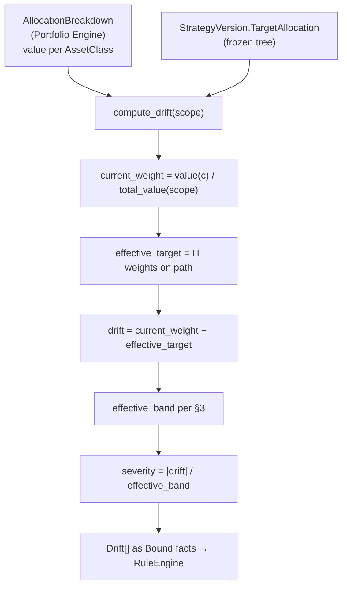
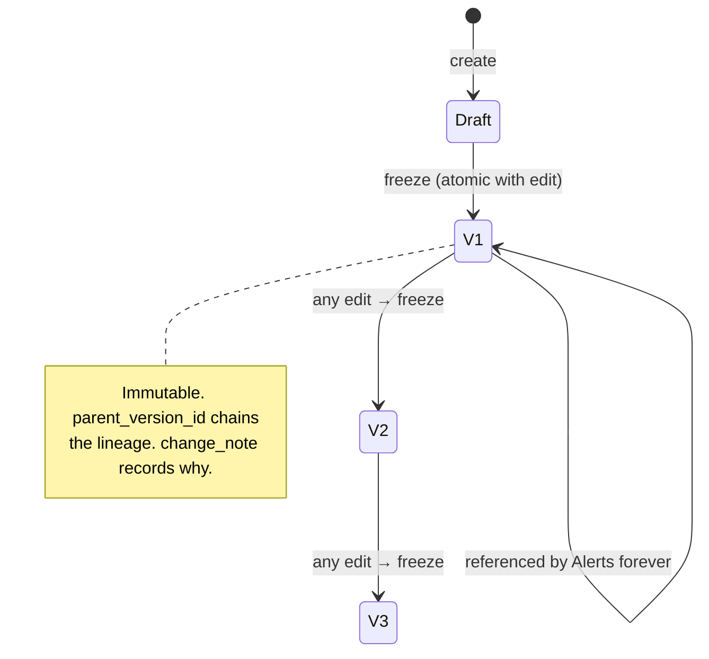

# RFC-0007 — Strategy Engine

| | |
|---|---|
| **Status** | Proposed |
| **Track** | Technical (0004–0010) |
| **Depends on** | RFC-0004 (Domain Model), RFC-0005 (Architecture), RFC-0009 (Schema), RFC-0006 (Rule Engine) |
| **Consumed by** | RFC-0008 (Decision Engine), RFC-0010 (Roadmap) |
| **Resolves** | Tolerance semantics (RFC-0006 §14.5); severity contract (RFC-0006 §14.1); bond valuation basis (RFC-0009 §10.6); valuation siting (RFC-0004 §10.4); `Goal`↔`Strategy` overlap (RFC-0004 §10.3) |
| **Language** | English. Ubiquitous Language verbatim per RFC-0003. |

---

## 1. Context

Manifest P2 makes `Strategy` a first-class object rather than configuration; P4 makes it instrument-independent and permanent while instruments are implementations. RFC-0004 gave `Strategy` an immutable `StrategyVersion` and keyed `TargetAllocation` by `AssetClass` (I-14). RFC-0006 consumes `drift` as a *fact* and computes nothing financial itself.

This RFC specifies what produces that fact, and closes five deferred questions.

**First, a boundary finding.** RFC-0003 names eight Domain Services and **"Strategy Engine" is not among them** — the same gap as `Decision Engine` (RFC-0004 E1). Drift could in principle belong to the Portfolio Engine, which RFC-0003 charges with *allocazione*. It cannot: computing drift requires the Strategy's targets, and RFC-0004 §4.1 fixed the dependency direction as *"Portfolio has no knowledge of Strategy."* Inverting that to put drift in Portfolio would make the most stable context depend on the most volatile one.

So the Strategy Engine is, like the Decision Engine, **a set of pure functions inside the `Strategy` bounded context — not a ninth Domain Service.** Recorded as extension **E8**.

---

## 2. Target Allocation: A Tree of Relative Weights

**Decision (ADR-0017): `TargetAllocation` is a tree. Each node's `weight` is relative to its parent. The children of any node sum to 1.**

RFC-0004 modelled `TargetAllocation` as a flat `Map[AssetClass, (Weight, Tolerance)]`. That is wrong for how strategies are actually expressed: *"60/40 equity to bonds, and within equity 70/30 developed to emerging."* Flattening that to six leaf percentages loses the structure that the author actually reasons about and edits.

```
root
├── EQUITY            0.60
│   ├── DEVELOPED     0.70   → effective 0.42
│   └── EMERGING      0.30   → effective 0.18
└── BONDS             0.40
    ├── GOV_EUR       0.75   → effective 0.30
    └── CORP_IG       0.25   → effective 0.10
```

**Effective target = product of weights along the root→leaf path.** Revised **I-13**: *the children of every node sum to 1* (with an explicit `Decimal` epsilon), which implies effective leaf weights sum to 1 without needing a separate global check.

Relative weights matter for one concrete reason: **restructuring a subtree is a local edit.** Changing the developed/emerging split does not touch the bonds subtree and does not renormalize anything outside `EQUITY`. Under absolute weights, every such change rewrites every number, and a git diff of the exported YAML becomes unreadable — which would quietly undermine ADR-0009's whole purpose.

**The skeleton uses a depth-1 tree**, which is exactly a flat allocation. So no extra work up front, and no migration later — the same subset relationship that ADR-0004 used for traces. This matters because `StrategyVersion` is immutable: introducing hierarchy afterwards would mean two `TargetAllocation` shapes and an engine that reads both, forever.

### 2.1 Targets attach to nodes; drift is computed at leaves

A `Tolerance` may be attached at any node. Drift is computed at **leaves**, because leaves are where `Asset`s map via `AssetClass`. Interior-node drift is a roll-up of its subtree and is reported, but a breach at an interior node is a distinct finding from a breach at a leaf: *"equity overall is on target, but the developed/emerging split inside it is not."*

Both are useful. Both are separate rules.

---

## 3. Tolerance Semantics — and a Correction

**Decision (ADR-0018): `ABSOLUTE(band)` is ±band in percentage points of scope weight. `RELATIVE(band)` is ±(band × effective_target).**

Your answer — that 5% means five percentage points — is adopted, and it lands on `ABSOLUTE`. But read strictly it also **collapses the two kinds into one**: if `RELATIVE(0.05)` were ±5pp, it would be identical to `ABSOLUTE(0.05)` and the `kind` discriminator in RFC-0004's `Tolerance` VO would be dead weight. So one of two things had to happen: delete `RELATIVE`, or give it the proportional meaning. I kept it proportional, because a percentage-point band is genuinely broken for small targets:

| Target | `ABSOLUTE(0.05)` band | `RELATIVE(0.25)` band |
|---|---|---|
| 40% | 35% – 45% | 30% – 50% |
| 18% | 13% – 23% | 13.5% – 22.5% |
| **4%** | **−1% – 9%** ← nonsense | 3% – 5% |

A ±5pp band on a 4% target permits the position to vanish entirely without registering a breach. The band is wider than the target. Any strategy with a small satellite allocation needs the proportional form, so `RELATIVE` earns its place.

This is the reasoning behind the industry's 5/25 convention — rebalance on 5 percentage points *or* 25% of target weight, whichever binds first — and V1.1 may add `CompositeTolerance(pp, proportional)` taking the tighter of the two. **V1 permits exactly one `Tolerance` per node**, with authoring guidance rather than automatic selection: `ABSOLUTE` above roughly 10%, `RELATIVE` below. Magic defaults on a number this load-bearing would be worse than a documented convention.

### 3.1 Severity: a dimensionless breach ratio

The contract RFC-0006 §14.1 promised RFC-0008, now fixed:

```
effective_band = band                          if ABSOLUTE
                 band × effective_target       if RELATIVE

severity       = |drift| / effective_band
```

`severity` is dimensionless: `1.0` is exactly at the band, `2.4` is 2.4× outside it. That is what makes ordering *within* a static `Priority` band meaningful and comparable across asset classes and tolerance kinds — an 8pp breach on a 40% target and a 1pp breach on a 4% target become directly rankable.

**Every `Condition` kind must emit `severity` or explicitly `null`.** RFC-0006's registry completeness test is extended to check this, so a kind cannot ship without declaring how urgent its findings are relative to each other.

---

## 4. Drift Computation



Every output is a `Bound` (RFC-0006 §4) carrying value, source refs, and observation time, so the trace populates itself.

Bindings emitted per leaf: `current_weight`, `current_value`, `effective_target`, `target_value`, `drift`, `drift_value`, `effective_band`, `severity`.

`drift_value = drift × total_value` exists purely for the message. *"Equity/Developed is 6.0% below target (−€3,240)"* is materially more actionable than the percentage alone, and it is the number a `Decision` actually acts on.

### 4.1 Edge cases, each with a defined outcome

| Situation | Behaviour |
|---|---|
| `total_value == 0` | `divide_safe` → `SKIPPED(zero_portfolio_value)`. A legitimate onboarding state. |
| Leaf has a target, no holding | `drift = −effective_target`, severity computed normally. Fires as ordinary under-allocation. |
| **Holding whose `AssetClass` has no target** | Contributes to `total_value` but has no target. Surfaced by a new condition kind — see §4.2. |
| Missing price for a held Asset | Portfolio Engine cannot value it → allocation incomplete → `SKIPPED(missing_fact)`. Never a partial denominator. |
| `AssetClass` not in the taxonomy | Domain error at import, not an evaluation outcome. |

The third row deserves emphasis because it hides a trap. Untargeted holdings **stay in the denominator**. This dilutes every other weight, so all targeted classes appear under-allocated. That is the honest reading — the capital genuinely is there — but it means an untargeted holding produces a scattering of small spurious under-allocation findings rather than one clear finding about itself. Excluding it from the denominator would suppress that noise while hiding real capital from the strategy, which is worse.

### 4.2 A required addition to RFC-0006's catalog

`untargeted_allocation(scope, threshold_weight)` — fires when a held `AssetClass` has no target in the governing `StrategyVersion`.

This is not a nice-to-have. It is the exact state RFC-0009 §2.2's Reconcile example produces: *"As classified today: Equity/Global at 34.0%, no target defined."* Under ADR-0012's correction model, reclassifying an `Asset` into a class the Strategy does not target is a **likely** event, and without this kind the consequence is silent dilution of every other target. Priority `HIGH`, `suggestion_class: REVIEW_STRATEGY`, `severity = current_weight / threshold_weight`.

---

## 5. Strategy as Policy, Applied Per Bucket

**Decision (ADR-0020): a `Strategy` is a *policy*; each governed `Bucket` is an independent instance of it. Drift is Bucket-scoped.**

RFC-0003 says a Strategy *governa Bucket* (plural) and carries one `target allocation` (singular). The only coherent reading is that the same policy applies to each governed Bucket independently: *"Pension"* and *"Children"* may both follow *"Long-term growth 80/20"*, each internally 80/20, without being pooled.

This reading is what makes P2 and P4 true rather than decorative. The Strategy is a durable statement of how this person invests; Buckets are the pots it is applied to; instruments are implementations. All three vary independently on their own timescales.

**Consequence for portfolio-level drift.** `scope: portfolio` is only meaningful when every `Bucket` in the Portfolio is governed by the *same* `StrategyVersion`. Otherwise there is no single target tree to compare against, and any number the UI displayed would be an average of incommensurable policies.

So: `scope: portfolio` evaluates normally under homogeneous governance, and otherwise yields `SKIPPED(heterogeneous_strategies)` — reusing RFC-0006's outcome machinery rather than inventing an error path, and surfacing in the run health panel. The alternative, silently averaging, is the kind of plausible-looking wrong number this architecture exists to prevent.

Unapportioned capital appears as the `UNASSIGNED` pseudo-bucket (I-9), which is governed by no Strategy and therefore has no drift — only `unassigned_residual_above` (RFC-0006 §3).

---

## 6. Valuation

### 6.1 Siting (closes RFC-0004 §10.4)

Valuation belongs to the **Portfolio Engine**: `Holding × price → value`, then grouped by `AssetClass` into `AllocationBreakdown`. Prices arrive as facts from the `price` table via the `PriceProvider` port (RFC-0009 §3.1). The Strategy Engine never touches a price — it consumes values. This keeps I-14 enforceable, since Strategy sees only `AssetClass` keys and monetary totals, never instruments.

### 6.2 Bond valuation basis (closes RFC-0009 §10.6)

**Decision (ADR-0019): `Asset.valuation_basis ∈ {MARKET, AMORTIZED_COST}`, defaulting to `MARKET`.**

For a BTP you intend to hold to maturity, marking to market injects drift you will never realize. Rates move, the price moves, your bond weight moves, and a drift rule fires — prompting deliberation about a position whose economics you have already committed to and which will redeem at par regardless. That is a rule firing on noise, and under P3 a confidently-explained spurious finding is worse than no finding.

`AMORTIZED_COST` values the position as purchase price amortized toward `redemption_value` over remaining life, plus accrued interest. Requires `maturity_date` and `redemption_value` on the `Asset`, and no price series at all — which also removes the hardest data-sourcing gap identified earlier, since free BTP price feeds barely exist.

**Reporting shows both.** Net worth renders at market — if you might sell, market is the truth — while drift computes at the declared basis. Divergence between them is displayed rather than reconciled, because it *is* the information: *"this position is €1,400 below cost at market; your drift uses amortized cost because you hold it to maturity."*

Changing `valuation_basis` follows ADR-0012's correction pattern: mutable in place, audit row required, repository-enforced. It is a statement about intent, and a changed intent is a correction to a previously mis-stated one.

Scoped to **V1.1** — the skeleton holds ETFs only. The model is fixed now because it determines what `price` means for bonds, and RFC-0009 could not leave that open indefinitely.

---

## 7. `StrategyVersion` Freeze Mechanics

Freeze is triggered by **any** change to the `Strategy` aggregate — targets, tolerances, rules, horizon, risk, principles, name, description. No materiality judgment. Deciding per-field which changes deserve a version is a distinction nobody can apply consistently three years later, and getting it wrong silently breaks I-11.



`StrategyVersion` fields beyond RFC-0004: `parent_version_id` (lineage) and **`change_note`** — a short user-authored statement of *why*, required on freeze.

`change_note` is the cheapest high-value field in the schema. ADR-0009 justified file export partly on *"how did my thinking change over three years?"*, and a git diff shows only *what* changed. The note is the only place the reasoning lives, it costs one text input at a moment when the reasoning is fresh, and it is unrecoverable later. It also feeds the V3 Knowledge context directly.

Freeze, the `Strategy.currentVersion` pointer move, and the YAML export are one transaction. A version that exists without its file, or a pointer to a version that was not written, are both states that must be unreachable rather than repaired.

---

## 8. Composition with the Rule Engine

Per RFC-0005 §3 the application service is the composition point; no engine calls another.

```
EvaluateStrategy:
  1. bucket ← BucketRepo.get(scope)
  2. sv     ← StrategyVersionRepo.get(bucket.governedBy.currentVersion)   # frozen once
  3. alloc  ← PortfolioEngine.compute_allocation(operations, assets, prices, apportionment)
  4. drift  ← StrategyEngine.compute_drift(alloc, sv.targets, scope)      # pure, this RFC
  5. derived← StrategyEngine.derive_indicator_facts(readings, sv.observed) # §8.1
  6. facts  ← FactSet(as_of, scope, targets, alloc, drift, derived, ...)
  7. firings← RuleEngine.evaluate(sv.rules, facts)                        # pure, RFC-0006
  8.        → DecisionEngine.materialize(firings, sv)                     # RFC-0008
```

Step 2 loading `sv` **once** is the P7 mechanism: one frozen definition flows through every subsequent step into the persisted `Provenance`. Nothing can drift mid-evaluation.

### 8.1 Derived indicator facts (closes RFC-0006 §14.4)

`indicator_percentile` needs a lookback series, and embedding a full series in every trace is bulky and unreadable. The Strategy Engine pre-computes it into a single `Bound`:

```
Bound(value="0.91",
      source={kind:"derived", engine:"strategy", method:"percentile_rank",
              window:"P10Y", inputs:["reading:...", ...]})
```

The value is what Stage A replays; `source.inputs` is what Stage B resolves. Consistent with ADR-0004 and it keeps traces legible.

### 8.2 Historical series

Per RFC-0009 §6, drift series render **as-recorded from `Snapshot`**, never recomputed. The Strategy Engine therefore has no "drift over time" function at all — Reporting reads Snapshots. Stated explicitly because a `compute_drift_series(from, to)` helper is the obvious thing to add and would silently fabricate history under ADR-0012's correction model.

---

## 9. `Goal` vs `Strategy.objective` (closes RFC-0004 §10.3)

RFC-0003 gives `Strategy` an `obiettivo` attribute *and* declares a `Goal` entity. Proposed disambiguation, requiring product ratification (**E9**):

| | `Strategy.objective` | `Goal` |
|---|---|---|
| Nature | Free-text prose — the *why* | Structured, measurable |
| Shape | Part of `RiskProfile`/principles | `(kind, target_value, target_date, status)` |
| Lifecycle | Frozen with `StrategyVersion` | Independent: `ACTIVE`/`ACHIEVED`/`ABANDONED` |
| Example | *"Preserve purchasing power over 20 years without timing markets"* | *"€60,000 by 2032"* |

These are different concepts and the source expresses both. Many-to-many between `Strategy` and `Goal` stands: one Goal may be served by several Strategies, one Strategy may serve several Goals. `goal_funding_gap` remains V2.

---

## 10. Testing

| Layer | Test |
|---|---|
| Tree invariant | Hypothesis: children of every node sum to 1 within epsilon; violations rejected at construction (I-13). |
| Effective weights | Property: leaf effective targets sum to 1 for any valid tree of any depth. |
| Tolerance | Table-driven across both kinds and the §3 matrix, including exactly-at-band boundaries. |
| Severity | Property: `severity` monotonic in `|drift|`; `severity == 1` exactly at the band. |
| Drift arithmetic | Golden fixtures with hand-computed values in `demo/expected/`. |
| Restructure locality | Editing one subtree leaves all other effective weights byte-identical — guards ADR-0017's core claim. |
| Heterogeneous scope | Mixed-Strategy Portfolio → `SKIPPED(heterogeneous_strategies)`, never a computed number. |
| Amortized cost | Value converges to `redemption_value` at maturity; no price input required. |

The restructure-locality test is the one that would catch a regression to absolute weights, which is the most likely way ADR-0017 gets accidentally undone.

---

## 11. Consequences

**Positive**

- Targets are expressed the way strategies are actually reasoned about, and subtree edits stay local — keeping exported YAML diffs meaningful.
- `severity` gives RFC-0008 a single dimensionless ordering key across every condition kind.
- `RELATIVE` tolerance makes small satellite allocations enforceable at all.
- Amortized cost removes spurious bond drift *and* the hardest price-data dependency in one decision.
- `scope: portfolio` degrades to `SKIPPED` rather than to a misleading average.
- `change_note` captures reasoning at the only moment it is available.

**Negative / accepted costs**

- **A tree is more machinery than a flat map**, including recursive validation and a UI that can edit nested structure. Mitigated by the depth-1 skeleton.
- **Two tolerance kinds is a real authoring decision** with no safe default, mitigated only by documented convention.
- **Untargeted holdings dilute every weight**, producing scattered small findings until `untargeted_allocation` is built. That kind is therefore V1, not optional.
- **Dual valuation basis means net worth and drift can disagree** — intended, but requires UI explanation or it reads as a bug.
- **Freeze-on-every-edit** produces versions for typo fixes. Accepted: the alternative is a materiality judgment nobody applies consistently.
- **E8 and E9 widen the source documents** and need product ratification.

---

## 12. Open Questions

1. **E9 ratification** — does the product track accept the `objective` / `Goal` split?
2. **`AssetClass` taxonomy ownership.** RFC-0004 assigned it to Portfolio, consumed opaquely by Strategy. But the tree's *shape* is a Strategy concern while class *membership* is a Portfolio concern. Workable, but the seam is thin: two Strategies wanting different groupings of the same classes cannot both be expressed. Deferred until a second Strategy exists.
3. **Interior-node tolerances in V1?** Defined here, but the skeleton's depth-1 tree cannot exercise them. Leaning: build leaf-only in V1, interior in V1.1 alongside the nested-tree editor.
4. **Accrued interest as income or value.** Under `AMORTIZED_COST`, accrued interest inflates position value until the coupon pays, then drops. Cleaner to exclude it from allocation and treat coupons purely as Cash Flow — but then bond value understates. Needs a decision before V1.1.
5. **Tolerance asymmetry.** Over-allocation and under-allocation may not warrant equal bands — being 5pp over on equities is not the same risk as 5pp under. `Tolerance(band_up, band_down)` is a small change and defensible; deferred as speculative until a real rule wants it.
6. **Rebalancing arithmetic.** *"Which contribution restores targets?"* is pure arithmetic given the tree, and Konty's author names it as their next feature. It is also the closest this system comes to prescription: computing a contribution split across `AssetClass`es is safe under I-12, but computing it across *instruments* is not. If built, it must emit `AssetClass` amounts only, and RFC-0008 must confirm the output cannot become a Recommendation field.

---

## Appendix A — ADR Index (cumulative additions)

| ADR | Title | Status | Owner RFC |
|---|---|---|---|
| ADR-0001…0016 | *(see RFC-0004, 0005, 0009, 0006)* | Accepted | — |
| ADR-0017 | Hierarchical `TargetAllocation` with relative weights | Accepted | RFC-0007 |
| ADR-0018 | Tolerance semantics: ABSOLUTE in pp, RELATIVE proportional | Accepted | RFC-0007 |
| ADR-0019 | Dual valuation basis for bonds | Accepted | RFC-0007 |
| ADR-0020 | Strategy as policy, applied per Bucket | Accepted | RFC-0007 |

---

### ADR-0017 — Hierarchical `TargetAllocation` with relative weights

**Context.** RFC-0004 modelled `TargetAllocation` as a flat map. Real strategies nest: an equity/bond split, then splits within each.

**Decision Drivers.** Match how the author reasons; keep subtree edits local so exported YAML diffs stay readable (ADR-0009); I-13 checkability; `StrategyVersion` immutability makes later change expensive.

**Considered Options.**
1. *Flat map, leaves only.*
2. *Hierarchical, absolute weights per node.*
3. *Hierarchical, weights relative to parent.*
4. *Flat in V1, hierarchical in V2.*

**Decision Outcome.** Option 3. Option 1 discards the structure the author actually edits. Option 2 requires renormalizing every number whenever one subtree changes, making git diffs noise and defeating ADR-0009. Option 4 is the trap: because `StrategyVersion` is immutable, two `TargetAllocation` shapes would coexist forever with an engine reading both. Option 3 makes I-13 a local per-node check and confines any restructure to one subtree.

**Consequences.** Recursive validation and a nested editing UI. Effective targets are computed, not stored, so a tree edit changes many effective weights at once — surfaced in the diff view rather than hidden. The skeleton's depth-1 tree is a strict special case, so nothing is retrofitted.

---

### ADR-0018 — Tolerance semantics

**Context.** RFC-0004 declared `Tolerance(kind: ABSOLUTE|RELATIVE, band)` without defining either against a target weight. RFC-0006 §14.5 flagged the ambiguity as blocking.

**Decision Drivers.** Author's stated reading (5% = five percentage points); non-redundancy of the `kind` discriminator; correct behaviour at small target weights; one authoring decision, not two.

**Considered Options.**
1. *Both kinds mean percentage points* — collapses to one concept.
2. *`ABSOLUTE` = pp; `RELATIVE` = proportional to effective target.*
3. *Composite: tighter of pp and proportional* (the 5/25 convention).

**Decision Outcome.** Option 2. Option 1 is the literal reading of the author's answer but makes `kind` dead weight, and leaves small targets unenforceable — a ±5pp band on a 4% target permits the position to disappear without a breach. Option 3 is what mature rebalancing frameworks use and is the likely V1.1 destination, but it doubles the authoring inputs before there is evidence a single band is insufficient.

**Consequences.** The author picks a kind per node, guided by convention (`ABSOLUTE` above ~10%, `RELATIVE` below) rather than by an automatic default. `severity = |drift| / effective_band` normalizes across both kinds, so RFC-0008 needs no knowledge of which was used. Option 3 remains reachable additively.

---

### ADR-0019 — Dual valuation basis for bonds

**Context.** For a BTP held to maturity, mark-to-market movement produces drift the holder will never realize. RFC-0009 deferred this to RFC-0007 while noting it changes what `price` means for bonds.

**Decision Drivers.** Avoiding rule firings on noise; P3 (a confidently-explained spurious finding is worse than none); scarcity of free BTP price data; net worth honesty if the position were sold.

**Considered Options.**
1. *Mark to market always.*
2. *Amortized cost for all bonds.*
3. *Per-`Asset` `valuation_basis`, default `MARKET`; report net worth at market, compute drift at the declared basis.*

**Decision Outcome.** Option 3. Option 1 generates drift findings on rate movements the strategy has committed to ignoring. Option 2 misstates net worth for bonds actually held as tradeable positions. Option 3 separates the two questions that were being conflated — *what is this worth* and *what should my strategy react to* — and as a side effect eliminates the need for a bond price feed, which was the least available data in the system.

**Consequences.** `Asset` gains `valuation_basis`, `maturity_date`, `redemption_value`. Reporting must display and explain a market/basis divergence or it reads as a bug. Basis changes follow ADR-0012's correction pattern with an audit row. Accrued-interest treatment is left open (§12.4). Scoped V1.1; the model is fixed now.

---

### ADR-0020 — Strategy as policy, applied per Bucket

**Context.** RFC-0003 says a Strategy governs Buckets (plural) and holds one target allocation (singular), without saying whether governed Buckets are pooled or independent.

**Decision Drivers.** P2 (Strategy as a representation of *how a person invests*); P4 (permanence and instrument-independence); avoiding meaningless aggregate numbers; I-3.

**Considered Options.**
1. *Pooled* — targets apply to the union of governed Buckets.
2. *Per-Bucket* — each governed Bucket independently instantiates the policy.
3. *Portfolio-level only* — one Strategy per Portfolio.

**Decision Outcome.** Option 2. Option 1 makes it impossible to know whether any individual Bucket complies, which is the question a Bucket exists to answer. Option 3 contradicts the plural in the source and forecloses the natural case of two pots following one policy.

**Consequences.** Drift is Bucket-scoped. `scope: portfolio` is meaningful only under homogeneous governance and otherwise yields `SKIPPED(heterogeneous_strategies)` rather than an average of incommensurable policies. A Strategy's cross-Bucket roll-up remains available for reporting, clearly labelled as aggregation rather than compliance.
