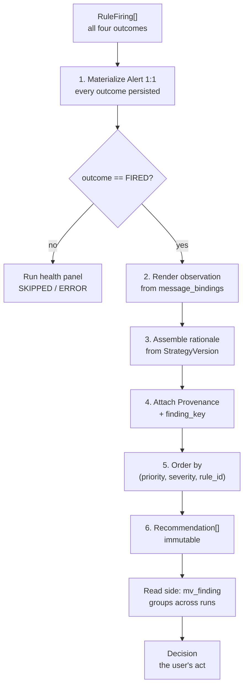

# RFC-0008 — Decision Engine

| | |
|---|---|
| **Status** | Proposed |
| **Track** | Technical (0004–0010) |
| **Depends on** | RFC-0004 (Domain Model), RFC-0005 (Architecture), RFC-0009 (Schema), RFC-0006 (Rule Engine), RFC-0007 (Strategy Engine) |
| **Consumed by** | RFC-0010 (Roadmap) |
| **Resolves** | `Decision Engine` status (RFC-0004 §8); severity ordering contract (RFC-0006 §14.1); rebalancing output constraint (RFC-0007 §12.6) |
| **Defines** | Alert/Recommendation materialization, the `Finding` read model, `Decision` lifecycle |
| **Language** | English. Ubiquitous Language verbatim per RFC-0003. |

---

## 1. Context

`Decision Engine` is a Vision pillar with no Domain Service and no bounded context in RFC-0003. RFC-0004 created the `Decision` context (E1) to hold `Alert`, `Recommendation`, and `Decision`, and asserted that `Decision Engine` is *a composition over the Rule Engine plus prioritization and deduplication*, not a ninth Domain Service. This RFC confirms that and specifies the composition.

It also does something the brief did not anticipate: **it moves deduplication out of the engine.** The brief asks the Decision Engine to generate, prioritize, deduplicate, and explain. Three of those four belong here. Dedup does not, and §4 argues why — putting it in the write path would require mutable Recommendations, which destroys the audit artifact that P3 and P7 exist to produce.

Manifest P1 is the constraint that shapes everything below: *"i dati non sono il prodotto, le decisioni sono il prodotto."* The `Decision` aggregate is therefore not an afterthought at the end of the pipeline — it is the thing the pipeline exists to produce.

---

## 2. What the Decision Engine Is

A **pure function** in `core/engines/decision_engine.py`, called by the `EvaluateStrategy` use case (RFC-0005 §3). No repository, no I/O, per I-7.

```
materialize(firings: RuleFiring[], sv: StrategyVersion, run: EvaluationRun)
    -> (alerts: Alert[], recommendations: Recommendation[])
```

Six steps, in order:



**Every FIRED Alert produces exactly one Recommendation.** RFC-0004's `Alert 1 <-- 0..1 Recommendation` cardinality holds because of *outcome*, not because of filtering: `SKIPPED`, `NOT_FIRED`, and `ERROR` produce none. There is no write-side path where a firing is silently dropped, which is what keeps the Alert table a complete audit record.

---

## 3. Ordering (confirms RFC-0006 §14.1)

Confirmed: the Decision Engine can implement static bands with dynamic ordering inside them, because RFC-0007 §3.1 puts `severity` in the trace bindings.

```
ORDER BY priority_rank DESC,        -- CRITICAL > HIGH > MEDIUM > LOW > INFO
         severity DESC NULLS LAST,  -- dimensionless breach ratio
         rule_id ASC                -- stable tiebreak
```

Three properties this buys:

- **Comparability across kinds.** `severity` is dimensionless, so a 2.4× band breach on `EQUITY_DEVELOPED` and a 2.4× breach on `CREDIT_SPREAD` rank equally — which is correct, and is unavailable if you sort on raw drift.
- **The author keeps control of what matters.** `Priority` is authored per Rule and is never overridden by computation. The system orders *within* the user's declared importance; it does not second-guess it. That is P6 expressed as a sort key.
- **Determinism.** The `rule_id` tiebreak means a re-run produces byte-identical ordering, which `input_digest` comparison depends on.

`NULLS LAST` is deliberate: a kind that cannot express its own urgency should not outrank one that can.

---

## 4. Deduplication Belongs on the Read Side

**Decision (ADR-0021): `Recommendation` stays immutable and 1:1 with a FIRED Alert. Deduplication is a derived read model, `mv_finding`, not a write-time operation.**

The problem is real. Evaluate weekly for six months with a persistent drift and you get 26 Recommendation rows saying the same thing. A naive UI is unusable by week three.

The tempting fix is a mutable Recommendation with `first_seen`, `last_seen`, `occurrences`, and `resolved_at`, updated in place on each run. **That fix is incompatible with the rest of this architecture.** RFC-0004 declares `Recommendation` immutable; RFC-0009 makes it an append-only fact; I-11 requires it to pin exactly one `StrategyVersion` and one `EvaluationRun`. Mutating it would mean a row whose `run_id` no longer identifies the run that produced its content — the audit artifact quietly stops being an artifact.

So the same principle used everywhere else applies here: **facts are immutable, views are derived.**

```sql
CREATE VIEW mv_finding AS
SELECT
    finding_key,
    arg_min(recommendation_id, r.recorded_at) AS first_recommendation_id,
    arg_max(recommendation_id, r.recorded_at) AS latest_recommendation_id,
    min(run.as_of)     AS first_seen,
    max(run.as_of)     AS last_seen,
    count(*)           AS occurrences,
    arg_max(a.severity, r.recorded_at) AS current_severity
FROM recommendation r
JOIN alert a          ON a.id = r.alert_id
JOIN evaluation_run run ON run.id = r.run_id
WHERE run.mode = 'ACTUAL'
GROUP BY finding_key;
```

`finding_key` is a stable natural key stored as a column on `recommendation`, computed by the engine:

```
finding_key = sha256(rule_id ‖ scope_id ‖ canonical(condition.params))
```

Not `strategy_version_id` — deliberately. Editing an unrelated Rule freezes a new `StrategyVersion` and would otherwise reset the finding's history, making "this has been drifting for five months" unanswerable. The key tracks the *finding*, and version lineage is already recoverable through `Provenance`.

A finding is **resolved** when its key is absent from the most recent `ACTUAL` run in which its rule was evaluated with outcome `NOT_FIRED`. That qualifier matters: absence because the rule was `SKIPPED` is not resolution, and treating it as such would be the same silent-false-reassurance failure ADR-0016 exists to prevent.

### 4.1 Correlated findings are not duplicates

Equity under target and bonds over target are mechanically the same imbalance seen twice. It is tempting to collapse them.

**Don't.** Suppressing one would be the system deciding which half of an imbalance the user should think about — a P6 violation dressed up as UX. The read side groups findings by `run_id` so they are visibly co-occurring, and the author can consolidate two rules into one if they find the pair noisy. That is an authoring decision, which is where it belongs.

---

## 5. Motivated, Never Prescriptive

Three layers, each structural rather than stylistic.

### 5.1 `observation` — what is true

Rendered from the Rule's `MessageTemplate` against `message_bindings` captured in the trace (RFC-0009 §4.1 property 4). Frozen into the row at creation, so re-rendering a March Recommendation in October reads only the March trace.

> *Equity/Developed is 6.0% below your target of 40.0% (tolerance ±2.0pp). Current: 34.0% (−€3,240).*

### 5.2 `rationale` — why it matters, in the user's own words

**Decision (ADR-0023): `rationale` is assembled from the `StrategyVersion`, not authored per Rule.**

This is the most consequential decision in this RFC and it is the one that makes Manifest P3 literally true. P3's example is *"**Secondo la tua strategia**, l'allocazione è fuori target del 6%"* — the authority is the user's own prior declaration, not the system's opinion.

So `rationale` is generated by citing the frozen `StrategyVersion`: its name and version, the target and tolerance that were breached, the horizon, and the relevant declared principle.

> *Your strategy "Long-term growth" (v3, frozen 12 Mar) targets 40% Equity/Developed with a ±2.0pp band over a 20-year horizon, on the stated principle "preserve purchasing power without timing markets."*

Two things follow, one of them unplanned:

- **The system never asserts that anything is appropriate for you.** It restates what you declared and reports arithmetic against it. Under the MiFID four-element test, element 3 — *presented as suitable for that person* — is not merely avoided by convention; there is no code path that could produce it, because the rationale generator's only inputs are your own frozen statements.
- **A weakly-articulated Strategy produces visibly weak rationales.** That is a feature. If the rationale reads thinly, the Strategy is thin, and the fix is upstream in the Strategy — which is exactly where the product wants your attention.

### 5.3 `suggestion_class` — a category of deliberation

The closed enum from RFC-0006 §7.2 (E7). No member can carry an instrument, a direction, or a size. Prose attaches to the class, not to free text per Rule.

### 5.4 Rebalancing arithmetic stays out (closes RFC-0007 §12.6)

**Decision: rebalancing computation is a read-side calculator, never a `Recommendation` field.**

Two independent reasons, and the second is the one that actually settles it:

1. **It isn't a finding.** A rebalancing split depends on a contribution amount the user types *now*. Freezing it into an immutable audit artifact would record a number that was never observed — a fabricated fact in the one table that must contain none.
2. **The regulatory line runs exactly here.** Contribution amounts per `AssetClass` are arithmetic against user-declared targets. The same computation across *instruments* is instrument selection. Keeping it off the `Recommendation` means the audit trail can never accumulate instrument-level prescriptions, however the read side later evolves.

The calculator, when built, emits `AssetClass` amounts only, lives in `adapters/duckdb/queries/`, and is reachable from a Recommendation view without ever writing to it.

---

## 6. The Explanation Surface

One permalinked page per Recommendation, `/recommendations/{id}`, which is the entire P3/P7 user interface. RFC-0005 §5.4 argued this URL is closer to a domain requirement than a convenience; here is what it contains.

| Block | Content | Source |
|---|---|---|
| Finding | `observation`, `suggestion_class`, `severity`, priority band | `recommendation` |
| Motivation | `rationale`, link to the `StrategyVersion` diff and its `change_note` | `strategy_version` |
| Bindings | Every input: name, value, and resolvable `source` | `alert.trace.bindings` |
| Computation | `steps` in order with intermediate values | `alert.trace.steps` |
| Provenance | `run_id`, `as_of`, `evaluated_at`, `engine_versions`, `input_digest` | `evaluation_run` |
| History | `first_seen`, `occurrences`, severity sparkline | `mv_finding` |
| **Reconcile** | Shown only when a recomputation diverges from `input_digest` | RFC-0009 §2.2 |
| Portfolio state | "What you held when this fired" — one join on `run_id` | `snapshot` |
| Decision | Existing `Decision`s referencing this, or a capture form | `decision` |

The chain a user can walk unaided: **Recommendation → Alert trace → Rule → StrategyVersion → your own change_note.** That is P7 as a sequence of links rather than a promise, and it is the reason the trace was designed as data in RFC-0009 rather than as a log line.

The **run health panel** is the necessary companion: `SKIPPED` and `ERROR` counts per run, with reasons. A strategy quietly skipping every rule is otherwise undiscoverable, and per ADR-0016 that is the failure mode most likely to mislead.

---

## 7. `Decision` — the User's Act

ADR-0002 fixed the shape; this RFC owns the lifecycle.

```
Decision = (id, informedBy: RecommendationId[], enactedBy: OperationId[],
            userRationale, decidedAt, status, defer_until?)

status ∈ { ENACTED | ACKNOWLEDGED | REJECTED | DEFERRED }
```

### 7.1 Dismissal is a Decision (ADR-0022)

The obvious design for "stop showing me this" is a `dismissed` flag on `Recommendation`. That is wrong twice over: it mutates an immutable artifact, and it throws away the most audit-worthy information in the system.

**Choosing not to act is a decision, and it is usually the more interesting one.** "In March the system told me equity was 6pp under target, and I decided to do nothing because I expected a bonus in May" is precisely what P7 exists to reconstruct. A boolean flag records that you clicked something; a `Decision` with `status = ACKNOWLEDGED` and one line of rationale records what you thought.

So suppression is expressed as a `Decision`, and the read side hides findings that have an `ACKNOWLEDGED` or `DEFERRED` Decision newer than the finding's `last_seen` — with `DEFERRED` additionally honouring `defer_until`. Nothing is mutated; visibility is derived.

`userRationale` is **optional**, and that is a deliberate concession. Requiring prose on every dismissal would train you to type "ok" — which is worse than an empty field, because it looks like a reason.

### 7.2 `informedBy` may be empty

A `Decision` with no informing Recommendation is legitimate and specifically valuable: acting against the system's findings, or with no finding at all, is the case most worth revisiting. The capture form is reachable from anywhere, not only from a Recommendation.

### 7.3 Linking `enactedBy`

Two orderings, both supported, neither pleasant:

- **Decide, then import.** The Decision exists with empty `enactedBy`; a later import offers to link new Operations. Requires a "Decisions awaiting enactment" surface.
- **Import, then decide.** Operations exist; the capture form offers recent unlinked Operations to attach.

**The honest cost, stated plainly:** this is the friction point of the whole product. Every other write in Finance OS corresponds to something that already happened; this one asks you to record a thought. ADR-0002 accepted that trade, and it remains the most likely feature to be quietly abandoned in month three. If that happens, the correct response is to delete it rather than let a half-populated `Decision` table imply an audit trail that does not exist.

`Decision` capture stays out of the walking skeleton (ADR-0002); the schema is fixed so nothing is retrofitted.

---

## 8. Hypothetical Runs Produce No Recommendations

**Decision: for `run.mode = 'HYPOTHETICAL'`, the Decision Engine materializes Alerts and traces but no Recommendations.**

This strengthens RFC-0009 §3.2, which relied on every read-side query remembering a `mode = 'ACTUAL'` predicate. A forgotten predicate in one query module is a plausible bug; a row that was never written cannot leak. The candidate-evaluation UI renders the engine's in-memory output directly, so the feature is unaffected.

Traces are still persisted, so "what was I considering in March, and what would it have said?" remains answerable — which was the point of persisting hypothetical runs at all.

---

## 9. Testing

| Layer | Test |
|---|---|
| Materialization | Every `FIRED` firing yields exactly one Recommendation; every other outcome yields none. |
| Ordering | Property: output order is a total order and is stable across re-runs of an identical `FactSet`. |
| `finding_key` | Property: invariant under `StrategyVersion` change; varies with `rule_id`, `scope`, or `params`. |
| Resolution | A finding resolves only on `NOT_FIRED`, never on `SKIPPED`. Regression test with a missing price. |
| I-12 structural | Reflection test: the `Recommendation` model exposes no field of instrument type and no `action`/`quantity` field. Fails the build if one is added. |
| `rationale` | Golden test: rendered from `StrategyVersion` fields only. A rationale referencing anything outside the frozen version fails. |
| Immutability | Repository port exposes no update or delete for `alert`, `recommendation`, `evaluation_run`. |
| Hypothetical | A `HYPOTHETICAL` run writes zero `recommendation` rows. |

The I-12 reflection test is the one worth writing first. It is the only mechanism that keeps a well-meaning future commit from adding a convenient `suggested_instrument` column, and it converts a philosophical commitment into a build failure.

---

## 10. Walking Skeleton Slice

Per RFC-0005 §8:

- `materialize` for one firing → one `Alert` → one `Recommendation`, with `observation`, assembled `rationale`, `Provenance`, and `finding_key`.
- Ordering implemented but trivially exercised at n=1.
- `mv_finding` created as a view. Cheap, and it means the recommendations list is built against the grouped shape from day one rather than being rewritten when the second run happens.
- **Out:** `Decision` capture, suppression, Reconcile block, run health panel, rebalancing calculator.

`mv_finding` in the skeleton is the one non-obvious inclusion. Building the list view against raw `recommendation` rows and migrating later would mean rewriting the primary UI surface after the second evaluation run — which is to say, immediately.

---

## 11. Consequences

**Positive**

- Immutability survives intact across the whole Decision context, so the audit chain has no mutable link.
- `rationale` assembled from the `StrategyVersion` makes P3 literal and closes the MiFID suitability element structurally rather than by policy.
- Static `Priority` with `severity` ordering keeps authorial control while making urgency comparable across kinds.
- Dismissal-as-`Decision` converts the least informative UI interaction into the most informative audit record.
- No Recommendations for hypothetical runs removes an entire class of leak.
- `finding_key` decoupled from `strategy_version_id` keeps long-running findings legible across strategy edits.

**Negative / accepted costs**

- **`mv_finding` is a view over a growing fact table.** Trivial now; if `recommendation` ever reaches millions of rows it becomes a materialized table, but the `mv_` prefix (RFC-0009 §3) already permits that swap without touching the port.
- **Suppression via derived visibility is harder to reason about** than a boolean column, and "why is this hidden?" needs its own explanation in the UI or it becomes the system's one unexplainable behaviour.
- **Correlated findings are not collapsed**, so an imbalance can present as two findings. Deliberate, but it will occasionally feel like noise.
- **`Decision` capture is the product's friction point** and the feature most at risk of abandonment (§7.3).
- **Assembled rationales are less expressive** than hand-written prose per Rule. Accepted: hand-written prose is where prescription would leak back in.

---

## 12. Open Questions

1. **Rationale localization.** Rationales are assembled from templates, so an Italian UI over English-authored `StrategyVersion` prose would mix languages mid-sentence. Deferred until the UI language is fixed, but it constrains how rationale templates are written.
2. **Notification.** V1 has no channel (ADR-0008), so a `CRITICAL` finding waits until you open the app. Fine for a weekly DSS; a genuine gap if a rule ever needs to be time-sensitive. Deferred to V2 alongside scheduled ingestion.
3. **Finding-level severity history.** `mv_finding` exposes `current_severity`; a sparkline needs the series. Cheap from `alert`, but it is the first read-side query that scans all runs for one finding. Index on `finding_key` when it appears.
4. **`REJECTED` vs `ACKNOWLEDGED`.** Both mean "not acting now." The distinction is only useful if the UI asks *why*, and asking adds friction to the interaction most in need of none. Leaning: ship `ACKNOWLEDGED` and `DEFERRED` only, add `REJECTED` if the distinction proves real.
5. **Decision templates.** Recurring decisions ("monthly contribution, split per target") are the most common real case and recording each by hand is tedious. A recurring-Decision concept would help, but it risks the system inferring decisions the user did not make. Deferred; V2 at the earliest.

---

## Appendix A — ADR Index (cumulative additions)

| ADR | Title | Status | Owner RFC |
|---|---|---|---|
| ADR-0001…0020 | *(see RFC-0004, 0005, 0009, 0006, 0007)* | Accepted | — |
| ADR-0021 | Findings as a derived read model | Accepted | RFC-0008 |
| ADR-0022 | Dismissal is a `Decision` | Accepted | RFC-0008 |
| ADR-0023 | `rationale` assembled from `StrategyVersion` | Accepted | RFC-0008 |

---

### ADR-0021 — Findings as a derived read model

**Context.** Repeated evaluation of a persistent condition produces one Recommendation per run. Over months the list becomes unusable, so findings must be grouped. RFC-0004 declares `Recommendation` immutable and RFC-0009 makes it an append-only fact.

**Decision Drivers.** Usable recommendation list; immutability of audit artifacts; I-11 (each Recommendation pins one run and one version); ability to answer "how long has this been drifting?".

**Considered Options.**
1. *Mutable Recommendation* with `first_seen`, `last_seen`, `occurrences`, `resolved_at`.
2. *One Recommendation per run*, plus a derived `mv_finding` view grouped on a stable `finding_key`.
3. *Write-time suppression* — skip creating a Recommendation when an identical one is open.

**Decision Outcome.** Option 2. Option 1 breaks immutability and produces rows whose `run_id` no longer identifies the run that generated their content. Option 3 loses the record that a condition fired again, which is exactly the information "this has been breached for five months" depends on, and makes the Alert table an incomplete audit record.

**Consequences.** `recommendation` grows with findings × runs, accepted alongside RFC-0009's `NOT_FIRED` volume. `finding_key` must be stable across `StrategyVersion` changes, so it is computed from `(rule_id, scope, params)` and excludes the version id. Resolution is defined only against `NOT_FIRED`, never `SKIPPED`.

---

### ADR-0022 — Dismissal is a `Decision`

**Context.** Users need to stop seeing a finding they have considered. The conventional mechanism is a `dismissed` flag on the notification.

**Decision Drivers.** Immutability of `Recommendation`; P7 (reconstruct why the user decided); P1 (decisions are the product); minimizing friction on a high-frequency interaction.

**Considered Options.**
1. *`dismissed` boolean on `Recommendation`.*
2. *A separate `suppression` table* keyed by finding.
3. *A `Decision` with `status = ACKNOWLEDGED | DEFERRED`*, with visibility derived.

**Decision Outcome.** Option 3. Option 1 mutates an immutable aggregate. Option 2 works but creates a second concept for something the domain already has a word for, and records only that a button was pressed. Option 3 captures what the user thought at the moment they chose not to act — under P7 the more valuable half of the record, since acting leaves `Operation`s behind and not acting otherwise leaves nothing.

**Consequences.** Visibility becomes a derived query rather than a column read, which is harder to debug and needs its own UI explanation. `userRationale` stays optional to avoid training the user to type filler. `DEFERRED` requires `defer_until` and a scheduled re-surface, which under ADR-0008 means "next time you open the app", not a notification.

---

### ADR-0023 — `rationale` assembled from `StrategyVersion`

**Context.** RFC-0009's `recommendation` table separates `observation` (what is true) from `rationale` (why it matters). Nothing specified what produces the latter.

**Decision Drivers.** P3's own example grounds the explanation in *"la tua strategia"*; I-12 non-prescriptiveness; the MiFID suitability element; not requiring the user to write prose twice.

**Considered Options.**
1. *Second user-authored template per Rule.*
2. *Assembled from the frozen `StrategyVersion`* — targets, tolerance, horizon, declared principles.
3. *Generated by an LLM* from the trace and the Strategy.

**Decision Outcome.** Option 2. Option 1 doubles the authoring burden and reintroduces free text as the place prescription leaks back in. Option 3 is rejected for V1 on P3 grounds before any privacy consideration: a generated rationale is not reconstructable from the trace, so it cannot be replayed, and an explanation that cannot be reproduced is not an explanation. The V3 AI assistant may *read* rationales; it must not author them.

**Consequences.** Rationales are formulaic, and their quality is bounded by how well the Strategy is articulated — which is a useful signal rather than a defect. Localization becomes a template concern (§12.1). The system has no code path that asserts suitability, because its only inputs are the user's own frozen declarations.
