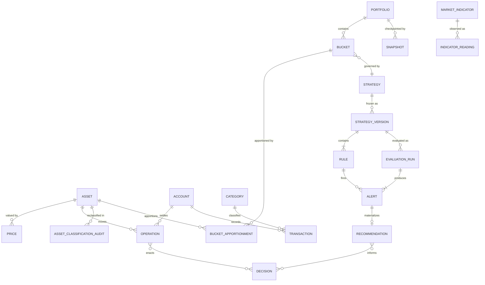
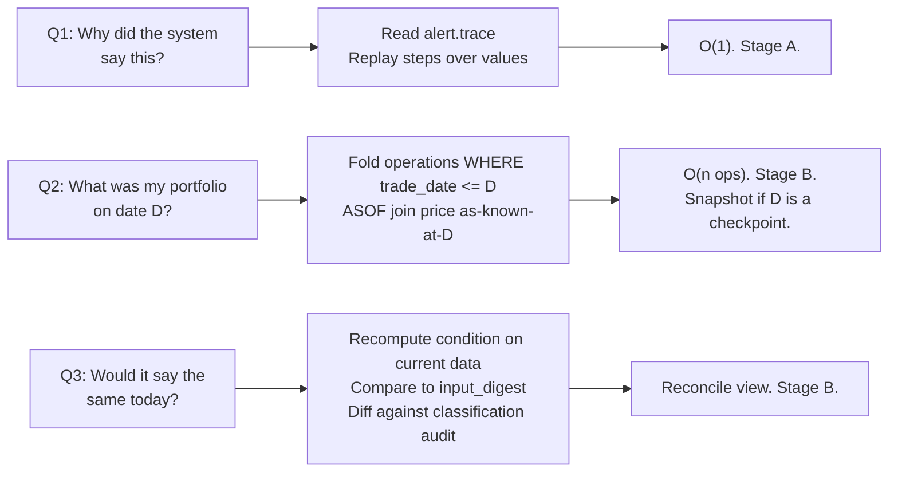

# RFC-0009 — Data & Event Model

| | |
|---|---|
| **Status** | Proposed |
| **Track** | Technical (0004–0010) |
| **Depends on** | RFC-0004 (Domain Model), RFC-0005 (Architecture) |
| **Consumed by** | RFC-0006 (Rule Engine), RFC-0007 (Strategy Engine), RFC-0008 (Decision Engine), RFC-0010 (Roadmap) |
| **Resolves** | **ADR-0004** (scope of reconstructability) — the last blocking decision |
| **Defines** | The `EvaluationTrace` and `Provenance` schemas that RFC-0006/0007/0008 consume |
| **Language** | English. Ubiquitous Language verbatim per RFC-0003. |

---

## 1. Context

RFC-0004 established that `Operation` is append-only, `StrategyVersion` is immutable, and `Alert`/`Recommendation` are immutable — and left ADR-0004 open. RFC-0005 chose DuckDB and deliberately avoided foreclosing either branch.

The framing of ADR-0004 as "event sourcing vs not" was too coarse. The real problem is narrower and sharper: **three inputs to every evaluation were freely mutable**, so P7's chain had links that could silently change meaning after the fact.

- `Asset.assetClass` — a plain mutable field, and the unit of every `TargetAllocation` (I-14).
- `VirtualHolding` apportionment — which ADR-0001 deliberately made a manual, editable user act.
- Prices — destroyed on every refresh if the price table is upserted rather than appended.

A reclassification in October changes what a March `Alert` means, and nothing in RFC-0004 detects it. For a system whose entire thesis is explanation over display, a silently invalidated explanation is the worst available failure mode.

This RFC resolves that, specifies the physical schema, and defines the trace and provenance objects.

---

## 2. ADR-0004 Resolved: Value-Pinned Traces Now, Targeted Temporality in V1

**Decision.** Not full event sourcing. Not naked references either. A staged approach in which the first stage is a strict subset of the second, so nothing is rewritten:

- **Stage A (walking skeleton).** `EvaluationTrace` stores fully-bound *values* of every input. Reconstruction of an evaluation is a single read. Every binding *also* carries a `source` reference which is recorded but not yet used for reconstruction.
- **Stage B (V1).** The `source` references become resolvable, because prices, apportionment, and operations are append-only and temporally queryable. Recomputation and counterfactuals become possible. **Existing traces stay valid** — the `source` field was there from day one.

That forward-compatible `source` field is the concrete mechanism that makes A ⊂ B. It is the single most important detail in this RFC.

**Why not full event sourcing.** The cost isn't the initial build; it's that every event type ever emitted must remain readable or be upcast, forever, on a solo project. What it buys over Stage B — rebuilding the entire world at an arbitrary timestamp — is delivered at coarse granularity by `Snapshot` for a fraction of the price.

### 2.1 Which things are temporal — and which are merely auditable

The distinction that keeps this cheap: **auditable ≠ temporal.** Recording that a change happened is nearly free. Making every query time-aware is not. Only the second is paid for below.

| Data | Posture | Rationale |
|---|---|---|
| `operation` | **Append-only.** Corrections are compensating Operations. | I-10. Already decided. |
| `transaction` | **Append-only**, same correction model. | Consistency with `operation`. |
| `price` | **Bitemporal append-only** — `(asset, valid_date, recorded_at)`. | Restatements genuinely happen, and Stage B needs price-as-known-then. |
| `indicator_reading` | **Bitemporal append-only.** | Macro series are revised routinely (inflation prints especially). |
| `bucket_apportionment` | **Temporal append-only**, effective-dated. | Re-apportioning is a *change of mind*, not a mistake. June's apportionment must not retroactively rewrite March's bucket drift. |
| `strategy_version` | **Immutable.** | Already decided (RFC-0004 E2). |
| `alert`, `recommendation`, `snapshot`, `evaluation_run` | **Immutable.** | Audit artifacts. |
| **`asset.asset_class`** | **Mutable in place + audit log. NOT temporal.** | Your decision: reclassification is a *correction*. See §2.2. |
| `account`, `category`, `portfolio`, `bucket`, `strategy`, `goal`, `market_indicator` | **CRUD, no history.** | Names and descriptions. No evaluation depends on their history. |

Note the deliberate asymmetry between the last two rows of the temporal group: **apportionment is a change, reclassification is a correction.** They look similar and behave oppositely. This follows from the decision recorded in ADR-0012 and is the one place I'd most expect you to push back.

### 2.2 Reclassification as correction — the consequence, and the feature

Choosing "correction rewrites history" removes the `asset_version` table Stage B would otherwise need. That's a real simplification. But it has a consequence that must be handled explicitly rather than hidden:

**Recomputing a past evaluation will legitimately disagree with its stored trace.** Under a version-history model that would be a bug. Under a correction model it is *intended* — and therefore the divergence is **information**, and the system must surface it.

Mechanism: the **Reconcile view**. For any past `Alert`, recompute the same `Condition` against current classifications and display both, labelled:

> *As evaluated (3 March): Equity/Developed at 34.0%, target 40.0%, drift −6.0% → fired.*
> *As classified today: Equity/Global at 34.0%, no target defined → would not fire.*
> *Premises changed: `asset:VWCE` reclassified 12 Oct, `EQUITY_DEVELOPED` → `EQUITY_GLOBAL`.*

This turns the weakness of the correction model into the thing your Manifest actually asks for: not just what the system said, but how your own understanding changed. `asset_classification_audit` exists precisely to render that third line.

**The residual cost, stated plainly:** any historical *series* — drift over time, allocation over time — has two possible readings, recomputed-under-current-taxonomy or as-recorded. They will not match. §6 fixes which one charts use.

---

## 3. Physical Schema

DuckDB. Three table classes, distinguished by name prefix so the read/write posture is visible at a glance in any query.

| Prefix | Class | Rule |
|---|---|---|
| *(none)* | Definition — mutable | Ordinary CRUD through repositories. |
| *(none)* | Fact — append-only | No `UPDATE`, no `DELETE`, ever. Enforced per RFC-0005 §5.2 and contract C6. |
| `mv_` | Materialized derived | Rebuildable from facts. Never a source of truth. Droppable at any time. |

Identifiers are **UUIDv7** stored as `UUID`: time-sortable, which matters for append-only logs, and generated behind the `IdGen` port so tests are deterministic.

Numeric types are fixed and non-negotiable: `DECIMAL(19,4)` for money, `DECIMAL(28,10)` for quantity, `DECIMAL(19,8)` for price, `DECIMAL(9,8)` for weight. `DOUBLE` appears nowhere in any table that feeds an evaluation.



### 3.1 Append-only facts

```sql
-- The atomic financial fact. Never updated; corrections are compensating rows.
CREATE TABLE operation (
    id              UUID PRIMARY KEY,
    type            VARCHAR NOT NULL,          -- BUY|SELL|DIVIDEND|COUPON|TRANSFER
    account_id      UUID NOT NULL REFERENCES account(id),
    asset_id        UUID NOT NULL REFERENCES asset(id),
    trade_date      DATE NOT NULL,             -- valid time
    quantity        DECIMAL(28,10) NOT NULL,   -- signed
    price           DECIMAL(19,8),
    fees            DECIMAL(19,4) NOT NULL DEFAULT 0,
    currency        VARCHAR(3) NOT NULL,
    import_batch_id UUID REFERENCES import_batch(id),
    corrects_id     UUID REFERENCES operation(id),   -- compensating link
    recorded_at     TIMESTAMPTZ NOT NULL,      -- transaction time
    CHECK (type <> 'BUY'  OR quantity > 0),
    CHECK (type <> 'SELL' OR quantity < 0)
);
CREATE INDEX ix_operation_asset_date ON operation(asset_id, trade_date);

-- Bitemporal. A restatement is a new row with a later recorded_at.
CREATE TABLE price (
    id           UUID PRIMARY KEY,
    asset_id     UUID NOT NULL REFERENCES asset(id),
    valid_date   DATE NOT NULL,
    close        DECIMAL(19,8) NOT NULL,
    currency     VARCHAR(3) NOT NULL,
    source       VARCHAR NOT NULL,   -- 'seed' | provider id; licence tracked in ADR
    recorded_at  TIMESTAMPTZ NOT NULL
);
CREATE INDEX ix_price_asset_valid ON price(asset_id, valid_date, recorded_at);

-- Effective-dated apportionment history. Supersession, not mutation.
CREATE TABLE bucket_apportionment (
    id             UUID PRIMARY KEY,
    bucket_id      UUID NOT NULL REFERENCES bucket(id),
    asset_id       UUID NOT NULL REFERENCES asset(id),
    quantity       DECIMAL(28,10) NOT NULL CHECK (quantity >= 0),
    effective_from DATE NOT NULL,
    supersedes_id  UUID REFERENCES bucket_apportionment(id),
    recorded_at    TIMESTAMPTZ NOT NULL
);
```

`price` deserves a note on why the bitemporal pair is worth two columns rather than one. `valid_date` answers *what was the closing price on 3 March*. `recorded_at` answers *what did we believe the 3 March close was, on 3 March*. Stage A traces embed the value they used; only `recorded_at` lets you later explain a discrepancy as a restatement rather than a bug. Querying "as known then" is a window function or an ASOF join, which is the whole reason RFC-0005 chose DuckDB.

### 3.2 The evaluation record

`EvaluationRun` is **new** — an extension beyond RFC-0004, tracked as **E4** (§8). It is the natural home for "what was the state of the world when this batch of Rules ran," and without it every `Alert` redundantly restates `as_of`, portfolio, and version.

```sql
CREATE TABLE evaluation_run (
    id                  UUID PRIMARY KEY,
    portfolio_id        UUID NOT NULL REFERENCES portfolio(id),
    strategy_id         UUID NOT NULL REFERENCES strategy(id),
    strategy_version_id UUID NOT NULL REFERENCES strategy_version(id),
    as_of               DATE NOT NULL,          -- domain date evaluated against
    evaluated_at        TIMESTAMPTZ NOT NULL,   -- wall clock
    mode                VARCHAR NOT NULL,       -- ACTUAL | HYPOTHETICAL
    engine_versions     JSON NOT NULL,          -- {"portfolio":"1.2.0","rule":"1.0.1",...}
    input_digest        VARCHAR NOT NULL        -- SHA-256 over canonical bound inputs
);

CREATE TABLE alert (
    id           UUID PRIMARY KEY,
    run_id       UUID NOT NULL REFERENCES evaluation_run(id),
    rule_id      UUID NOT NULL REFERENCES rule(id),
    outcome      VARCHAR NOT NULL,   -- FIRED | NOT_FIRED | SKIPPED | ERROR
    priority     VARCHAR NOT NULL,
    trace        JSON NOT NULL,      -- §4
    recorded_at  TIMESTAMPTZ NOT NULL
);
```

Two decisions embedded there that are not obvious:

**`NOT_FIRED` outcomes are persisted.** P7 asks why you decided. "Nothing fired" is as much an explanation as a firing, and without these rows you cannot reconstruct that the system was silent *or why*. Volume is trivial — ten Rules evaluated weekly is roughly 500 rows a year. `Alert` therefore means "a rule evaluation record," and only `outcome = 'FIRED'` surfaces in the UI. This slightly widens RFC-0004's reading of `Alert` as "evento generato da una Rule"; recorded as **E5**.

**`input_digest`** is a hash over the canonical serialization of every bound input. It answers "would this evaluate identically today?" in one comparison, without recomputing anything — which is what makes the §2.2 Reconcile view cheap enough to render on a list page.

`mode = 'HYPOTHETICAL'` supports the candidate-asset evaluation flow. Hypothetical runs are persisted (so you can revisit what you were considering) but **excluded from every read-side query by default**, via a mandatory predicate in the query modules. A hypothetical firing must never appear in the recommendations list.

### 3.3 Definitions, and the classification audit

```sql
CREATE TABLE asset (
    id           UUID PRIMARY KEY,
    name         VARCHAR NOT NULL,
    asset_class  VARCHAR NOT NULL,        -- mutable: correction model
    currency     VARCHAR(3) NOT NULL,
    identifiers  JSON NOT NULL            -- [{"scheme":"ISIN","value":"IE00B4L5Y983"}]
);

-- Auditable, not temporal. Renders the "premises changed" line in Reconcile.
CREATE TABLE asset_classification_audit (
    id           UUID PRIMARY KEY,
    asset_id     UUID NOT NULL REFERENCES asset(id),
    from_class   VARCHAR NOT NULL,
    to_class     VARCHAR NOT NULL,
    reason       VARCHAR,
    changed_at   TIMESTAMPTZ NOT NULL
);
```

Writing the audit row is enforced in the repository, not left to the caller: `AssetRepository.reclassify(asset_id, to_class, reason)` is the only path that can change `asset_class`, and it writes both rows in one transaction. There is no generic `update(asset)` that touches the class.

### 3.4 Derived models

`Holding` is a **view** in V1, not a table (ADR-0003). At this data volume the fold is microseconds and a materialized table would be a cache with no cache to justify.

```sql
CREATE VIEW mv_holding AS
SELECT o.asset_id, p.id AS portfolio_id, SUM(o.quantity) AS quantity
FROM operation o
JOIN portfolio_account p ON p.account_id = o.account_id
WHERE o.type IN ('BUY','SELL','TRANSFER')
GROUP BY 1, 2
HAVING SUM(o.quantity) <> 0;
```

The `mv_` prefix is kept despite this being a view, because the repository port's signature must not change when it becomes a table. When it does, the promotion is one migration and zero application changes.

---

## 4. The Trace and Provenance Schemas

This is what RFC-0006/0007/0008 build against. **Stored as JSON, not `STRUCT`** — a reversal of what RFC-0005 §5.2 implied, reasoned in ADR-0013.

### 4.1 `EvaluationTrace`

```json
{
  "trace_version": 1,
  "condition": {
    "kind": "drift_outside_tolerance",
    "params": { "asset_class": "EQUITY_DEVELOPED", "scope": "bucket:8f3a..." }
  },
  "bindings": [
    { "name": "target_weight", "value": "0.4000",
      "source": { "kind": "strategy_version", "ref": "sv:1f2c...",
                  "path": "targets.EQUITY_DEVELOPED.weight" } },
    { "name": "tolerance", "value": { "kind": "ABSOLUTE", "band": "0.0200" },
      "source": { "kind": "strategy_version", "ref": "sv:1f2c...",
                  "path": "targets.EQUITY_DEVELOPED.tolerance" } },
    { "name": "current_weight", "value": "0.3400",
      "source": { "kind": "derived", "engine": "portfolio",
                  "inputs": ["op:4a1b...", "op:9c2d...", "price:7e5f..."] } }
  ],
  "steps": [
    { "op": "subtract", "in": ["current_weight", "target_weight"],
      "out": "drift", "value": "-0.0600" },
    { "op": "abs_gt", "in": ["drift", "tolerance.band"],
      "out": "breached", "value": true }
  ],
  "outcome": "FIRED",
  "message_bindings": { "asset_class_label": "Equity/Developed",
                        "drift_pct": "-6.00", "target_pct": "40.00",
                        "current_pct": "34.00" }
}
```

Four properties are load-bearing, and RFC-0006 must not weaken any of them:

1. **Every binding carries both `value` and `source`.** `value` is what Stage A replays. `source` is what Stage B resolves. This is the whole A ⊂ B mechanism.
2. **`steps` are explicit and ordered.** Not prose — a small algebra of named operations over named bindings. This is what makes replay mechanical rather than interpretive, and it is why RFC-0006's `Condition` must compile to this form rather than to a Python lambda.
3. **Decimals are serialized as strings.** JSON numbers are IEEE 754 doubles. A trace that round-trips `0.4` as `0.4000000000000001` is not an audit artifact.
4. **`message_bindings` are captured, not re-derived at render time.** The message you saw in March must be reproducible verbatim, even if the `MessageTemplate` is later edited — which it can be, since it lives inside a frozen `StrategyVersion`, so in practice this guards against template-rendering changes rather than template edits.

**The replay contract, which is RFC-0005's P3 property test:** given `condition` plus the `value` of every binding and ignoring all `source` fields, re-executing `steps` must reproduce `outcome` exactly. If a `Condition` kind cannot satisfy this, it does not ship. That single rule is what stops I-6 from being decorative.

### 4.2 `Provenance`

Promoted to columns on `recommendation` rather than nested in JSON, because these are queried and joined:

```sql
CREATE TABLE recommendation (
    id                  UUID PRIMARY KEY,
    alert_id            UUID NOT NULL REFERENCES alert(id),
    run_id              UUID NOT NULL REFERENCES evaluation_run(id),
    strategy_version_id UUID NOT NULL REFERENCES strategy_version(id),
    rule_id             UUID NOT NULL REFERENCES rule(id),
    observation         VARCHAR NOT NULL,   -- what is true
    rationale           VARCHAR NOT NULL,   -- why it matters, per the Strategy
    suggestion_class    VARCHAR,            -- nullable, non-instrument
    input_refs          JSON NOT NULL,      -- ["op:...","price:...","reading:..."]
    recorded_at         TIMESTAMPTZ NOT NULL
);
```

I-12 is visible in the absence: there is no `instrument`, no `action`, no `quantity` column. A prescriptive Recommendation is not merely discouraged, it is unrepresentable — which is also the §MiFID firewall from ADR-0010, expressed as DDL.

---

## 5. How Reconstruction Actually Works

Three distinct questions, three mechanisms, three costs.



Q1 works from the skeleton onward and needs nothing but the trace. Q2 needs the append-only price series, so it arrives with Stage B. Q3 is the §2.2 Reconcile view and is the payoff for the correction model.

### 5.1 Snapshots

`Snapshot` is a **checkpoint and a series source, never a source of truth.** Rebuildable from facts, so it may be dropped and regenerated.

```sql
CREATE TABLE snapshot (
    id            UUID PRIMARY KEY,
    portfolio_id  UUID NOT NULL REFERENCES portfolio(id),
    as_of         DATE NOT NULL,
    run_id        UUID REFERENCES evaluation_run(id),
    total_value   DECIMAL(19,4) NOT NULL,
    currency      VARCHAR(3) NOT NULL,
    allocation    JSON NOT NULL,   -- {"EQUITY_DEVELOPED":{"value":"...","weight":"..."}}
    by_bucket     JSON NOT NULL,
    recorded_at   TIMESTAMPTZ NOT NULL
);
```

**Cadence: written on every `evaluate` run**, plus on explicit demand. Not nightly — RFC-0005 has no scheduler by design. This has a pleasant consequence: because a `Snapshot` shares its `run_id` with the `Alert`s produced in the same run, "what did my portfolio look like when this Recommendation appeared" is a single join rather than a reconstruction.

Snapshots serve Reporting (series), Forecast (input series), and Q2 acceleration. They do **not** serve evaluation — Rules read live derived state, never a Snapshot, so a stale checkpoint can never cause a spurious firing.

---

## 6. Which Truth Do Charts Show?

The correction model forces this choice explicitly, and getting it wrong produces charts that quietly contradict the trace views.

**Decision: historical series render as-recorded, from `Snapshot`. Never recomputed under current classifications.**

A "drift over time" chart built by recomputing history under today's taxonomy would show drift you never actually saw, at dates when the system was telling you something else. That is a fabricated history — precisely the *"mostrano ciò che è successo"* failure the Manifest rejects, made worse by being wrong.

Consequence to accept: after a reclassification, a series will show a discontinuity at the reclassification date. That is honest, and the `asset_classification_audit` row lets the chart annotate it: *"12 Oct — VWCE reclassified Equity/Developed → Equity/Global."* An unexplained jump is a bug; an annotated one is information.

---

## 7. Migration Posture

**Forward-only numbered SQL** plus a `schema_version` table, applied on startup inside a transaction. No down-migrations. Justification: solo project, single database instance, and the recovery path below is strictly more reliable than a reverse migration nobody tested.

```
adapters/duckdb/migrations/
  001_init.sql
  002_add_evaluation_run.sql
  ...
```

### 7.1 The recovery gap RFC-0005 left open

RFC-0005 §6 claimed the recovery story is "re-run migrations on a fresh file, re-import the retained raw CSVs." That covers *derivable* data only. It silently loses everything **authored**, which is most of the actual value:

| Class | Recovery |
|---|---|
| **Derivable** — Operations, Transactions, prices, readings | Re-import from retained raws (RFC-0005 §6). |
| **Authored** — apportionment, Strategies, Rules, Decisions, Categories, asset classifications | **No recovery path existed.** |

Closed by requiring `financeos export --authored` to emit a complete, canonical, re-importable YAML bundle, and running it automatically after every migration and before every schema change. Strategies already have this via ADR-0009; this generalizes it to the other four.

This is not a backup convenience. It is the only thing that makes forward-only migrations safe, and it must exist before migration `002`.

### 7.2 Schema-change classes

| Change | Procedure |
|---|---|
| Additive column, nullable | Plain `ALTER TABLE`. |
| Additive column, required | Add nullable → backfill → add constraint, in one migration. |
| New table | `CREATE TABLE`. |
| Rename or retype | New column, backfill, dual-read one release, drop later. Never in-place on a fact table. |
| Derived model change | Drop and recreate. Never migrated — that's the point of `mv_`. |
| **Trace schema change** | **Never migrate stored traces.** Bump `trace_version`, keep readers for every prior version. |

The last row is the one long-term commitment this design makes. It's deliberately much narrower than event-sourcing's upcasting tax: one versioned JSON document type, not every event in the system.

---

## 8. Extensions Beyond RFC-0004

| ID | Extension | Rationale |
|---|---|---|
| **E4** | `EvaluationRun` as a first-class aggregate. | Groups Alerts from one evaluation; carries `as_of`, `mode`, `input_digest`. Without it every Alert restates run-level context and hypothetical runs cannot be cleanly excluded. |
| **E5** | `Alert` widened to "rule evaluation record" — `NOT_FIRED` persisted. | RFC-0004 read `Alert` as "evento generato da una Rule". P7 requires reconstructing silence, not just firings. UI shows only `FIRED`, so the domain-facing meaning is unchanged. |
| **E6** | `asset_classification_audit`. | Makes the correction model honest without making `Asset` temporal. |

E4 and E6 are technical and need no product ratification. **E5 does** — it changes what the word `Alert` denotes in the Ubiquitous Language, and the product track should either accept the widening or supply a second term.

---

## 9. Consequences

**Positive**

- P7 is answerable at three distinct granularities (§5), each with a known cost, rather than being one vague promise.
- Stage A → Stage B is additive. The skeleton's traces remain valid forever because of one `source` field written from day one.
- `input_digest` makes "have the premises changed?" a comparison, not a recomputation — which is what makes Reconcile affordable on a list view.
- The correction model, plus the audit table, turns reclassification from a silent corruption into a visible feature.
- I-12 is enforced by the absence of columns. The regulatory firewall from ADR-0010 is DDL, not policy.
- Snapshots sharing `run_id` with Alerts makes "what did I own when this fired" a join.

**Negative / accepted costs**

- **Two time columns on three tables** is real conceptual overhead. Every query against `price` must decide between latest-known and as-known-then, and getting it wrong is a silent wrong number. Mitigation: only two query helpers exist, `price_latest()` and `price_as_known_at()`, and no query module may inline a `price` join.
- **Historical series show discontinuities** at reclassification dates. Honest, but requires annotation to not look broken.
- **`NOT_FIRED` rows** mean `alert` grows with rules × runs rather than with findings. Trivial now; needs a retention policy if rule count grows an order of magnitude.
- **`trace_version` readers accumulate forever.** The narrowest possible version of event-sourcing's tax, but not zero.
- **The authored-data export (§7.1) is now load-bearing infrastructure**, not a nice-to-have — forward-only migrations are unsafe without it.
- JSON traces are not statically typed at the storage layer. Pydantic validates at the boundary; DuckDB will store a malformed trace if the boundary is bypassed.

---

## 10. Open Questions

1. **E5 ratification** — does the product track accept `Alert` meaning "rule evaluation record", or supply a second term for non-firings?
2. **Apportionment vs reclassification asymmetry** (§2.1). I made apportionment temporal and reclassification a correction. Defensible, but they are structurally similar and you may want them uniform. This is the decision in this RFC I am least confident about.
3. **`NOT_FIRED` retention.** Keep forever, or prune beyond N runs while retaining all `FIRED`? Leaning keep forever until it measurably hurts.
4. **Tamper-evidence** (carried from RFC-0005 §10.3). A hash chain over fact tables would restore what DuckDB's lack of per-table grants removed. `input_digest` already gives per-run integrity; chaining `recorded_at`-ordered rows is a small increment. Leaning V1.1.
5. **Price licence recording.** Once a provider is chosen, its terms belong in an ADR, and `price.source` should carry enough to reconstruct which licence governed which row.
6. **Bond valuation basis.** For a BTP held to maturity, marking to market injects drift you will never realize. Amortized cost may be the honest basis. This is RFC-0007's decision but it changes what `price` means for bonds, so it cannot be deferred indefinitely.
7. **Multi-currency** still deferred. When it lands, `price` and `snapshot` both need an FX-rate dimension with the same bitemporal treatment.

---

## Appendix A — ADR Index (cumulative)

| ADR | Title | Status | Owner RFC |
|---|---|---|---|
| ADR-0001 | Bucket apportionment model | Accepted | RFC-0004 |
| ADR-0002 | Definition of `Decision` | Accepted | RFC-0004 |
| ADR-0003 | `Holding` as derived read model | Accepted | RFC-0004 |
| ADR-0004 | Scope of reconstructability | **Accepted** | RFC-0009 |
| ADR-0005 | Local store: DuckDB single file | Accepted | RFC-0005 |
| ADR-0006 | Pydantic v2 in the domain core | Accepted | RFC-0005 |
| ADR-0007 | UI: FastAPI + Jinja2 + HTMX | Accepted | RFC-0005 |
| ADR-0008 | Single process, on-demand ingestion | Accepted | RFC-0005 |
| ADR-0009 | Strategy files as derived artifacts | Accepted | RFC-0005 |
| ADR-0010 | Defer commercialization posture | Accepted | RFC-0005 |
| ADR-0011 | Corrections as append-only supersession | Accepted | RFC-0009 |
| ADR-0012 | Reclassification as correction | Accepted | RFC-0009 |
| ADR-0013 | Trace stored as JSON, not STRUCT | Accepted | RFC-0009 |

---

### ADR-0004 — Scope of reconstructability

**Context.** Manifest P7 requires every Decision to be reconstructable. RFC-0004 delivered append-only Operations and immutable StrategyVersions but left three evaluation inputs mutable: `Asset.assetClass`, apportionment, and prices. The scope of reconstructability was left open as the last blocking decision.

**Decision Drivers.** P7 and P3; shortest path to a working V1; avoiding a permanent schema-evolution tax on a solo project; ability to detect when a past conclusion's premises have changed; not paying for time travel that will be used twice.

**Considered Options.**
1. *Trace-embedded values only* — trace is self-contained; nothing else temporal.
2. *Targeted temporality* — version only the three mutable inputs; traces pin references.
3. *Full event sourcing* — all state as projections of an event log.

**Decision Outcome.** Staged: Option 1 for the walking skeleton, Option 2 for V1, with Option 1's traces forward-compatible by construction. Every trace binding carries both `value` (replayable now) and `source` (resolvable under Option 2), so the transition is additive and no trace is ever migrated.

Option 3 is rejected on lifecycle cost, not build cost: every event type must remain readable or be upcast forever, and the incremental capability over Option 2 — arbitrary-timestamp world rebuild — is delivered coarsely by `Snapshot` for far less. Option 1 alone is insufficient because it cannot detect that a reclassification changed a past conclusion's meaning, and reclassification is a near-certain event for anyone refining a strategy.

**Consequences.** Two time columns on three tables, with the attendant risk of querying the wrong one — mitigated by allowing only two named price accessors. One versioned JSON document type whose readers accumulate. In exchange, P7 becomes answerable at three defined granularities, and the Reconcile view (§2.2) exists.

---

### ADR-0011 — Corrections as append-only supersession

**Context.** Fees get restated, prices get revised, macro series get benchmarked. The question is whether the originally recorded value stays queryable.

**Decision Drivers.** Stage A traces embed values, so explaining a trace/reality discrepancy requires knowing what was believed when; P7; cost of bitemporality; avoiding it where it earns nothing.

**Considered Options.**
1. *Overwrite in place.*
2. *Bitemporal append-only everywhere.*
3. *Bitemporal append-only on the three tables where restatements occur; CRUD elsewhere.*

**Decision Outcome.** Option 3. Option 1 makes a trace/reality discrepancy permanently inexplicable — you cannot distinguish "restated" from "bug", which is the one distinction an audit trail exists to make. Option 2 imposes as-of reasoning on `category` and `account` names, where no evaluation depends on history and the cost is pure.

**Consequences.** `operation`, `price`, `indicator_reading` carry `recorded_at`; `bucket_apportionment` carries `effective_from` and `supersedes_id`. Every read of these must choose a temporal predicate, which is the main new footgun in the schema — hence exactly two named accessors and a prohibition on inline `price` joins in query modules.

---

### ADR-0012 — Reclassification as correction

**Context.** When an `Asset`'s `AssetClass` changes, is that fixing a past error or recording a change from now on? `AssetClass` is the key of every `TargetAllocation` (I-14), so this determines whether past drift computations remain meaningful.

**Decision Drivers.** Author's stated intent (a reclassification means the earlier classification was wrong); simplicity; not fabricating history; making changed premises visible.

**Considered Options.**
1. *Correction* — one current truth; history recomputes differently.
2. *Change* — effective-dated `AssetClass` versions; history preserved as-was.
3. *Both* — user chooses per reclassification.

**Decision Outcome.** Option 1. It removes an entire version table relative to Option 2 and matches the author's stated semantics. Option 3 is the most expressive and rejected as premature: it asks a subtle question at every reclassification before there is evidence the distinction matters in practice.

Accepting Option 1 obliges the system to handle its one real weakness explicitly: recomputation legitimately disagreeing with a stored trace. Hence `asset_classification_audit` (E6) and the Reconcile view — the divergence is surfaced as information rather than silently resolved either way.

**Consequences.** Historical series show discontinuities at reclassification dates, requiring annotation. Charts must render as-recorded from `Snapshot` (§6), never recomputed. If reclassification turns out to be frequent, Option 2 remains reachable — but retrofitting it cannot recover history already collapsed, so the audit table is the hedge and must be populated from day one.

---

### ADR-0013 — Trace stored as JSON, not STRUCT

**Context.** RFC-0005 §5.2 cited DuckDB's `LIST`/`STRUCT` types as a reason to prefer it, specifically for storing an `EvaluationTrace` without shredding it. On specifying the trace, that turns out to be the wrong tool.

**Decision Drivers.** Trace shape varies by `Condition` kind and RFC-0006 will add kinds over time; no migration of historical traces; type safety at the boundary; queryability of the handful of fields actually filtered on.

**Considered Options.**
1. *`STRUCT` column* — typed at the storage layer.
2. *JSON column* + promoted scalar columns for queried fields.
3. *Fully shredded relational trace* — tables for bindings and steps.

**Decision Outcome.** Option 2. A `STRUCT` must be widened for every new `Condition` kind, meaning a schema migration touching a fact table each time RFC-0006 grows — the opposite of what a versioned audit document needs. Option 3 makes replay a multi-table reconstruction and offers query power over trace internals that nothing needs.

Fields actually filtered on — `outcome`, `rule_id`, `run_id`, `priority` — are promoted to real columns. Everything else lives in JSON behind `trace_version`.

**Consequences.** No storage-layer type enforcement on trace bodies; Pydantic validates at the boundary and a malformed trace is possible if that boundary is bypassed. Reversal of a claim in RFC-0005 §5.2 — DuckDB's remaining advantages (ASOF joins, window functions, Arrow interop) are untouched, but the `STRUCT` argument should not be cited for it again.
